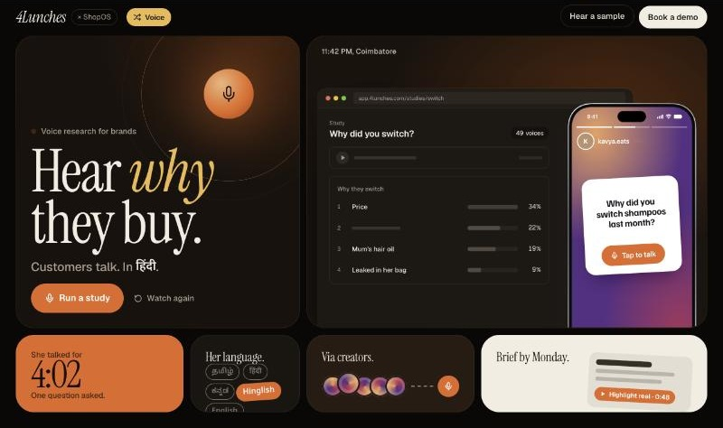
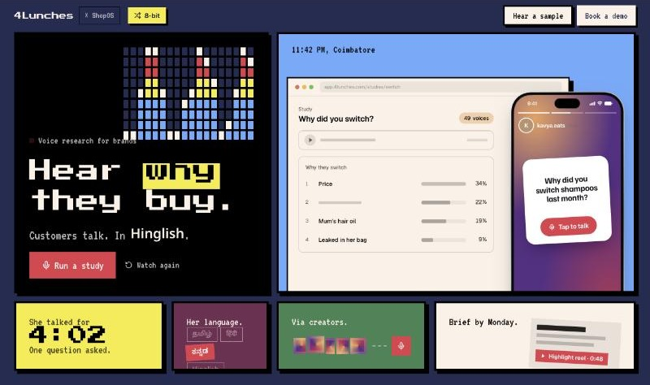

<div align="center">

# 🎙️ 4Lunches, voice research

### *hear why they buy. customers talk, in their own language.*


`voice research` · `landing page` · `two skins` · `multilingual` · `× ShopOS concept` · `nov 2026`

</div>

---

> 🎙️ **what this is.**
> a landing page concept for voice-first customer research.
> brands ask "why did you switch?", and customers just *talk*.
> in Hinglish. in हिंदी. in தமிழ். in ಕನ್ನಡ. in English.
> an AI interviewer listens, asks one follow-up, and turns hundreds of voices into a brief by Monday.
> the page has two skins: a playful 8-bit one and a clean voice one. flip between them. 🔀

---

## 📍 inside

```
 1. 🍿  the short version
 2. 📋  why surveys lie
 3. 🗣️  "customers talk"
 4. 🔀  two skins, one page
 5. 🍱  the bento
 6. 🧪  a mock study
 7. 🧭  what we reverse-engineered
 8. 🛠️  how to make your own
 9. 🚀  possibilities
10. 📚  lessons
```

---

## 🍿 1. the short version

Brands want to know one thing.
**Why do people buy?** 🛒

The usual answer is a survey.
Ten questions. Tick boxes. 1 to 5 stars.
People rush it. Or skip it.
And you learn almost nothing.

Voice research flips that.
You ask one open question.
People talk for four minutes.
In whatever language feels natural.

That's where the real reasons live.
Not in the tick boxes.
In the "umm, actually, it's because my mom…" 🗣️

This page sells that idea.
And it does it by *showing* voices, not describing them.

---

## 📋 2. why surveys lie

```
   📋 SURVEY                          🎙️ VOICE
   ─────────────────────              ─────────────────────
   "rate us 1-5"           ★★★★☆      "honestly? the smell."
   you pick the options               they pick the words
   English only                       any language
   2 minutes, rushed                  4 minutes, relaxed
   tells you WHAT                     tells you WHY
   ticks a box                        tells a story
```

Surveys aren't *lying* exactly.
They just ask the wrong way.

When you give people options,
they pick the closest one.
Even if it's not quite true.
"Price" wins, because it's on the list. 💸

When you just let them talk,
they say things you'd never have listed.
"The pack fits in my scooter dicky."
"My kid likes the colour."
"I saw my neighbour use it." 🏘️

Those are the reasons that change a brand.
And they only show up in voice.

---

## 🗣️ 3. "customers talk"

The headline is the whole pitch.

```
   ┌───────────────────────────────────────┐
   │                                       │
   │      Customers talk. In Hinglish.     │
   │                         ↓ (cycles)    │
   │      Customers talk. In हिंदी.          │
   │      Customers talk. In தமிழ்.          │
   │      Customers talk. In English.      │
   │                                       │
   │          Hear why they buy.           │
   │                                       │
   └───────────────────────────────────────┘
```

The last word keeps changing.
Hinglish. हिंदी. தமிழ். ಕನ್ನಡ. English.
Each in its own script. ✍️

That one animated word does a lot:
- It *shows* multilingual, instead of claiming it.
- It's honest about India. People mix languages mid-sentence.
- It makes the page feel alive.



Hinglish is the key one.
Most tools pretend people speak "Hindi" or "English".
Real people speak both. In one breath.
"Yaar, the delivery was so fast, I was shocked." 😄
A tool that handles that is a tool that works in India.

---

## 🔀 4. two skins, one page

This is the fun part.
The page has a toggle.
Two complete looks. Same content.



```
   🔀 THE SKIN TOGGLE

   ┌─────────────────┐       ┌─────────────────┐
   │ 👾 8-BIT         │       │ 🎙️ VOICE         │
   │                 │  ⇄    │                 │
   │ pixel font      │       │ clean sans      │
   │ chunky blocks   │       │ soft cards      │
   │ arcade colours  │       │ calm palette    │
   │ game energy     │       │ product energy  │
   └─────────────────┘       └─────────────────┘
            same words. same sections. same data.
```

Why two skins?

**👾 8-bit** is for the founder crowd.
Playful. Memorable. Screenshot-able.
It says "we're not a boring research firm".

**🎙️ Voice** is for the brand manager.
Clean. Trustworthy. Easy to forward to a boss.
It says "this is a real product".

Same page, two audiences.
And the toggle itself is a conversation starter.
People flip it back and forth just to see. 🔁

Building it as skins also kept us honest.
If the content only works in one look,
the content is weak.
Both skins had to land the same message.

---

## 🍱 5. the bento

The middle of the page is a bento grid.
Each tile is one proof point.

```
   🍱 THE BENTO

   ┌───────────────────────┬──────────────┐
   │ 🎧 "She talked for    │ 🌐 Her        │
   │    4:02, one question │   language    │
   │    asked"             │ தமிழ் हिंदी    │
   │  ▁▂▅▇▅▃▂▁▂▅▇▆▃        │ ಕನ್ನಡ Hinglish │
   ├──────────────┬────────┴──────────────┤
   │ 📲 Via        │ 📄 Brief by Monday     │
   │   creators   │   voices → themes →    │
   │              │   one page             │
   └──────────────┴───────────────────────┘
```

**🎧 "She talked for 4:02, one question asked".**
This is the headline stat in tile form.
One question. Four minutes of answer.
That's the whole value, in one line.

**🌐 "Her language".**
The scripts shown side by side.
தமிழ். हिंदी. ಕನ್ನಡ. Hinglish. English.
No claim needed. You see it.

**📲 "Via creators".**
How you reach people.
Creators share the link with their audience.
Real customers, not a paid panel.

**📄 "Brief by Monday".**
The output.
Not a 90-page deck. One brief. Fast.

Every tile answers one doubt:
"Will they talk?" "In what language?" "How do you find them?" "What do I get?" ✅

---

## 🧪 6. a mock study

Lower down, the page runs a pretend study.
So you see what a result looks like.

```
   🧪 STUDY: "Why did you switch?"
   ─────────────────────────────────────
   🎙️ 49 voices

   THEMES
   ████████████████  "it just works better"
   ███████████       "a friend told me"
   ████████          "the old one got pricier"
   █████             "the pack is nicer"
   ███               "saw it on Instagram"

   ▶️ hear a clip   ▶️ hear a clip   ▶️ hear a clip
```

This is the money shot. 💰
The themes come out of the voices.
Each theme links back to real clips.
So a brand manager can *hear* the evidence.

That's the difference from a chart.
A chart says "32% said quality".
A clip lets you hear someone *say* it.
With their tone. Their pause. Their laugh.
That's what convinces a boardroom. 🎧

One clip can end a long debate.
The team argues about price for an hour.
Then someone plays a customer saying it's the smell.
The room goes quiet. Decision made. 🤐

The study on the page is a mock.
Made-up numbers. Made-up themes.
Clearly a demo, so nobody mistakes it for real data.

---

## 🤖 6½. the interviewer

The page promises "one question asked".
So the AI interviewer has to be shy. 🤫

Most AI interviewers talk too much.
They ask ten follow-ups.
They summarise back. They say "great point!"
People clam up. It feels like a test.

The rules we wrote for ours:

```
   🤖 INTERVIEWER RULES

   1. ask the one question. then stop.
   2. let silence sit. 3-4 seconds is fine.
   3. one follow-up, only if they stop early.
   4. the follow-up uses THEIR words, not ours.
   5. never correct their language. never translate back.
   6. no "great answer!". no scoring. no judging.
   7. end with "anything else?" — the best bits come last.
```

Rule 2 is the hardest. ⏳
Silence feels awkward.
But silence is where people keep going.
"…and actually, the other thing is…"
That second thought is usually the gold.

Rule 4 is the clever one.
If she said "the pack feels premium",
the follow-up is "what makes it feel premium?"
Not "tell us about packaging quality".
Her words. Not a researcher's words.

Rule 7 is from real interviewers.
The door-handle moment. 🚪
People share the real stuff right before leaving.
So always leave the door open.

### 🧹 what happens after

```
   🎙️ voice  →  📝 transcript  →  🏷️ tags  →  🧩 themes  →  📄 brief
      (any       (kept in the      (what was    (grouped     (one page,
     language)    original lang)    said)        across       clips linked)
                                                 voices)
```

Transcripts stay in the language spoken.
Translation happens only for the brief.
So nothing gets lost too early.
A Tamil phrase stays Tamil until the very end. 🌐

---

## 🧭 7. what we reverse-engineered

This page started as a study of a voice-research product site.
We pulled it apart, then rebuilt the idea for India. 🇮🇳

```
   🧭 THE TEARDOWN

   WHAT WE STUDIED               WHAT WE CHANGED
   ───────────────               ───────────────
   one language                  five, mixed freely
   panel recruiting              creators share the link
   long report                   brief by Monday
   one look                      two skins
   "AI interviewer" claims       show a 4:02 voice instead
```

The method:

1. **Screenshot every section.** Hero, proof, process, pricing, footer.
2. **Write each section's one job.** "This tile proves people will talk."
3. **Find the gap for your market.** For us: language and reach.
4. **Rebuild the jobs, not the pixels.** Same jobs. Our words. Our look.
5. **Write it as a file.** We turned the learnings into a short LISTEN.md, a skill file for running voice studies.

That last step matters.
A teardown that ends as a page is nice.
A teardown that ends as a reusable file is useful. 📄

No assets, copy or brand from the original were used.
Just the lessons.

---

## 🎨 7½. small design calls that mattered

**〰️ The waveform is decoration with a job.**
It's not a real recording.
But it *signals* "audio" in half a second.
Before you read a word, you know it's about voices.

**🔤 Real scripts, real fonts.**
Tamil and Kannada need fonts that render them well.
Broken glyphs would kill the whole message.
So every script got tested on phones. 📱

**⏱️ "4:02", not "4 minutes".**
A precise time feels real.
"About four minutes" feels like marketing.
Specific beats round. Always.

**👩 "She", not "users".**
The tile says "She talked for 4:02".
One person. A real-feeling story.
"Users talk for an average of 4 minutes" is a stat.
"She talked for 4:02" is a moment. 💬

**👾 The 8-bit skin keeps the same grid.**
Only the paint changes.
So switching skins never makes you hunt.
Things stay where your eye left them.

---

## 🛠️ 8. how to make your own

### 📋 the steps

1. **One question, open-ended.** "Why did you switch?" not "Rate our price".
2. **Let them pick the language.** And let them mix.
3. **One follow-up, max.** The interviewer listens more than it asks.
4. **Recruit through people they trust.** Creators, communities, WhatsApp groups.
5. **Cluster into themes.** Each theme links to real clips.
6. **Ship a one-page brief.** Fast beats thorough.
7. **For the landing page:** animate the language word, show a real voice length, and build a bento of doubts answered.

### 🤖 a starter prompt

```
Build a landing page for a voice-first customer research product.
Hero: "Customers talk. In ___." where the last word cycles through
Hinglish, हिंदी, தமிழ், ಕನ್ನಡ, English in their own scripts. Add a
skin toggle: an 8-bit arcade skin and a clean "voice" skin with the
same content. Bento grid: "She talked for 4:02, one question asked"
with a waveform, "Her language" with scripts, "Via creators", "Brief
by Monday". Then a clearly-labelled mock study ("Why did you
switch?", 49 voices) with theme bars and play buttons on clips.
```

---

## 🚀 9. possibilities

```
   🚀 WHERE VOICE RESEARCH GOES

   🛒 post-purchase voice notes   "tell us in 30 seconds" after delivery
   🔁 always-on listening         a study that never closes, themes update weekly
   🧠 brand memory                every voice feeds what the brand knows about buyers
   🎬 ad scripts from voices      real customer lines become ad hooks
   🌍 any language                Bengali, Marathi, Malayalam, next
   🤝 creator studies             creators run studies with their own fans
```

**🎬 Ad scripts from voices** is the spicy one.
The best ad lines are things real customers said.
"It fits in my scooter dicky" is a better hook than any copywriter's line.
Voice research → ad creative → better ads. 🔥

**🧠 Brand memory** is the deep one.
Every study adds to a living file of "why people buy".
Next campaign starts with that file.
Not with a blank page.

---

## 📚 10. lessons

**1. Ask one open question.** ❓
The less you ask, the more they say.

**2. Language is the unlock.** 🌐
People explain best in the language they think in. Often two at once.

**3. Show, don't claim.** 👀
An animated script beats "we support 12 languages".

**4. Two skins test your content.** 🔀
If it only works in one look, rewrite it.

**5. Every tile answers one doubt.** 🍱
Will they talk? In what language? How? What do I get?

**6. Clips beat charts.** 🎧
Let the boardroom hear the customer.

**7. Mocks must look like mocks.** 🧪
Label demo data clearly. Always.

**8. End a teardown with a file.** 📄
Turn what you learned into something you can reuse.

**9. Specific beats round.** ⏱️
"4:02" feels real. "About four minutes" feels like marketing.

**10. Let silence work.** 🤫
The interviewer's best tool is saying nothing. The second thought is the gold.

---

<div align="center">

```
   🎙️  ▁▂▅▇▅▃▂▁▂▅▇▆▃▂▁▂▃▅▇▅▃▂  4:02
   ─────────────────────────────────────
     customers talk. in their language.
            hear why they buy. 🛒
```

*part of [reverse-engineered](../README.md) by [sai](https://5aitec.com) · made with Claude*

</div>
