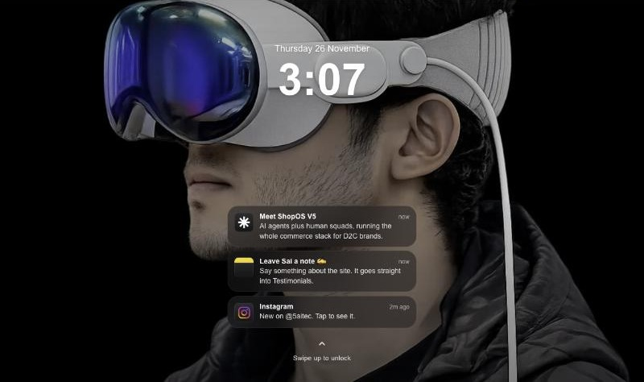
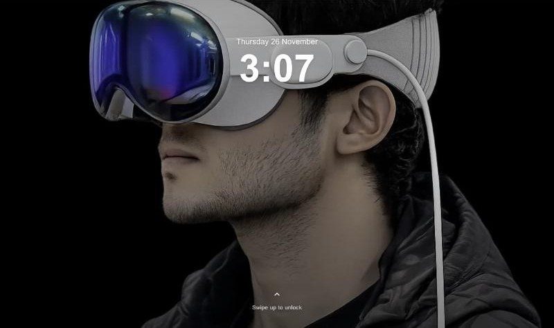

<div align="center">

# 📱 5aitec, the phone

### *a personal site that opens like an iPhone. lock screen, notifications, apps.*



`personal site` · `portfolio` · `iOS-style UI` · `5aitec.com` · `nov 2026`

</div>

---

> 📱 **what this is.**
> my personal site, [5aitec.com](https://5aitec.com), rebuilt as a phone.
> you land on a lock screen. there's a photo of me. the time. notifications.
> swipe up and you're in. every part of my work is an app.
> ShopOS. SeeIt. photos. notes. book a call.
> it's a portfolio you already know how to use. 👆

---

## 📍 inside

```
 1. 🍿  the short version
 2. 😴  why most personal sites are boring
 3. 🔒  the lock screen
 4. 🔔  notifications as a feed
 5. 🧩  apps as the work
 6. 🧭  what we reverse-engineered
 7. 🐛  what broke in capture
 8. 🛠️  how to make your own phone site
 9. 🚀  possibilities
10. 📚  lessons
```

---

## 🍿 1. the short version

Most personal sites look the same.
A big name. A photo. "I build things."
Then a list of projects nobody clicks. 😴

I wanted mine to be something you *play with*.
So I asked one question:
**what's the interface everyone already knows?**

The phone. 📱

Everyone knows how a lock screen works.
Everyone knows notifications.
Everyone knows apps.
Zero learning curve.

So the site *is* a phone.
My work lives inside it as apps.
My news shows up as notifications.
And you unlock it with a swipe. ⬆️

---

## 😴 2. why most personal sites are boring

```
   THE USUAL PERSONAL SITE 🥱

   ┌──────────────────────────────┐
   │  HI, I'M [NAME] 👋            │
   │  I build things.             │
   │  [ photo ]                   │
   │  ── projects ──              │
   │  • thing 1                   │
   │  • thing 2                   │
   │  • thing 3                   │
   │  ── contact ──               │
   └──────────────────────────────┘

   problems:
   😐 looks like every other one
   📜 a scroll, not an experience
   🙈 nobody reaches the bottom
   🔁 no reason to come back
```

A personal site has one job.
Make people remember you.
A list doesn't do that.
A *thing you played with* does. 🎮

---

## 🔒 3. the lock screen



You land and it's a lock screen.
Just like your phone.

```
   THE LOCK SCREEN 🔒

   ┌──────────────────────────────┐
   │        Thursday 26 November   │
   │             3:07              │  ← live date & time
   │                               │
   │      [ photo: me in a         │
   │        Vision Pro ]  🥽        │  ← the wallpaper
   │                               │
   │  🔔 notification              │
   │  🔔 notification              │
   │  🔔 notification              │
   │                               │
   │       swipe up to unlock ⬆️    │
   └──────────────────────────────┘
```

Small things that matter:

**🕐 The time is real.**
Your date. Your time.
It feels alive from second one.

**🥽 The wallpaper is me.**
In a Vision Pro.
Because I spent years in spatial computing.
The photo tells that story without a word.

**⬆️ "Swipe up to unlock".**
The one instruction you need.
And you already know it from muscle memory.

The lock screen is the hook.
Five seconds in, you *get* it.
"Oh, it's a phone." 😄
And you want to see what's inside.

---

## 🔔 4. notifications as a feed

The notifications are the clever bit.
They're my news feed.
Dressed up as notifications.

```
   🔔 NOTIFICATIONS = WHAT'S NEW

   ┌──────────────────────────────────────┐
   │ 🟣 ShopOS                     now     │
   │ Meet ShopOS V5 — AI agents plus       │
   │ human squads…                         │
   ├──────────────────────────────────────┤
   │ ✍️ Notes                      2m      │
   │ Leave Sai a note ✍️ … goes straight   │
   │ into Testimonials                     │
   ├──────────────────────────────────────┤
   │ 📸 Instagram                  1h      │
   │ New on @5aitec                        │
   └──────────────────────────────────────┘
```

Three notifications. Three jobs:

1. **📣 The launch.** What I'm shipping right now.
2. **✍️ The ask.** "Leave me a note." It lands in Testimonials.
3. **📸 The content.** My latest post.

That's a whole homepage.
News, social proof, content.
In three little cards. 🃏

And it's honest about *time*.
"now", "2m", "1h".
It feels like these are happening.
Because they kind of are.

The note one is my favourite.
Visitors leave a note.
It shows up in a Testimonials app.
The site writes itself over time. ✍️

### 🗞️ notifications age like news

Notifications have a hidden superpower.
They *expect* to change.

Nobody's surprised when a phone shows new ones.
So swapping them weekly feels natural.
A homepage hero that changes weekly feels chaotic.
A notification that changes weekly feels *normal*. 🔄

```
   WEEK 1    🔔 launch V5     🔔 leave a note   🔔 new reel
   WEEK 2    🔔 a talk        🔔 leave a note   🔔 new essay
   WEEK 3    🔔 SeeIt update  🔔 leave a note   🔔 new reel
                               ▲
                     the ask stays pinned
```

Two rotate. One stays pinned.
The ask for a note never leaves.
Fresh news on top. A steady invite under it.

And it doubles as a tiny changelog.
Come back a month later, see what moved.
That's a reason to come back. 🔁

---

## 🎨 4½. the colour of it

The palette comes from the wallpaper.
Not from a brand book.

Warm skin tones. Dark headset. Soft studio light.
So the glass cards pick up a warm tint.
Swap the photo, and the whole mood shifts.
The site wears the photo like an outfit. 👕

---

## 🧩 5. apps as the work

Swipe up and you land on a home screen.
Each app is a part of my world.

```
   THE HOME SCREEN 🧩

   ┌──────────────────────────────┐
   │  🟣 ShopOS    👓 SeeIt        │
   │  📸 Photos    📝 Notes        │
   │  ✍️ Testimonials  📅 Book a call│
   │                               │
   │  ── dock ──                   │
   │  💬  📧  🌐  🎵               │
   └──────────────────────────────┘
```

**🟣 ShopOS** opens the company.
What it does. What's new.

**👓 SeeIt** opens the glasses lab.
Open-source AI smart glasses.

**📸 Photos** is a camera roll.
Real moments. Not a "gallery" page.

**📝 Notes** holds the writing.
Short thoughts, like a notes app.

**📅 Book a call** is the CTA.
Dressed as a calendar app.
So booking a call feels normal, not salesy.

The rule: **every app does one thing.**
Just like a real phone.
You never wonder where something is.

```
   WEBSITE THINKING      →    PHONE THINKING
   ────────────────           ──────────────
   "About" page               the wallpaper
   "Blog"                     Notes app
   "Portfolio"                Photos / app icons
   "Contact"                  Book a call app
   "News"                     notifications
   "Testimonials"             a notes app people write in
```

Every boring website section maps to a phone thing.
That mapping *is* the design. 🗺️

---

## 🏗️ 5½. how it's built

Under the glass, it's a plain web page.
No app store. No framework drama.

```
   THE LAYERS 🏗️

   ┌─────────────────────────────────┐
   │ 🔔 notification cards (glass)    │  ← top layer
   ├─────────────────────────────────┤
   │ 🕐 clock + date (big type)       │
   ├─────────────────────────────────┤
   │ 🖼️ wallpaper photo               │
   ├─────────────────────────────────┤
   │ 🧩 home screen (hidden till      │  ← slides up on unlock
   │    unlock)                       │
   ├─────────────────────────────────┤
   │ 📄 real text + links for SEO     │  ← always there
   └─────────────────────────────────┘
```

**🪟 The frosted glass.**
Each notification is a blurred card.
The photo glows through softly.
That blur is what makes it read as "phone".
Flat white boxes would look like a website. 

**🔤 The big clock.**
Huge, thin numbers.
Small date above.
Your eye lands on it first.
Then drifts down to the cards.

**🖥️ On desktop.**
A phone in the middle of a laptop screen is odd.
So desktop shows the phone as an object.
Centred. Soft background around it.
Like holding it up to show a friend. 🤳

**📱 On mobile.**
It just *is* the screen.
Full bleed. Feels native.
This is where it shines.
People open it, grin, and swipe.

**⚡ Speed.**
One photo. A few cards. Some icons.
It loads fast, even on a bad signal.
A slow lock screen would break the spell.

```
   THE UNLOCK, FRAME BY FRAME ⬆️

   0 ms     👆 finger down on the lock screen
   →        lock screen follows your finger up
   →        home screen peeks in behind it
   past ½   let go, and it finishes the slide
   ~300 ms  🧩 home screen, apps settle in
```

The slide follows your finger.
That's the detail that makes it feel real.
A button that just "switches pages" would feel fake.
A slide that tracks your thumb feels like a phone. 👍

---

## 🧭 6. what we reverse-engineered

The reference was obvious: iOS.
But copying iOS isn't the point.
Copying the *habits* is.

```
   iOS HABITS WE BORROWED 🍎

   🔒 lock screen as a first impression
   🔔 notifications as "what's new"
   ⏱️ relative time (now, 2m, 1h)
   ⬆️ swipe to unlock
   🧩 one app = one job
   🪟 frosted glass cards over a photo
   🔤 big clock, small details
```

And what we deliberately *didn't* borrow:
- No Apple logos.
- No Apple icons.
- No real iOS assets.

The habits are universal.
The pixels are ours. ✋

The method, step by step:

1. **Pick a UI everyone knows.** Phone. Desktop. Game menu. TV guide.
2. **List its habits.** Not its looks. Its *behaviours*.
3. **Map your content to those habits.** News → notifications. CTA → an app.
4. **Build only the habits that carry content.** Skip the rest.
5. **Keep it a website underneath.** Links, text, SEO. Still works.

---

## 🐛 7. what broke in capture

Honest moment. 🙃

When I went to screenshot this for the repo,
the swipe-up wouldn't unlock in the capture browser.
The lock screen came through fine.
The home screen didn't.

```
   🐛 THE BUG

   real finger swipe      ✅ unlocks
   synthetic swipe        ❌ stays locked
   (screenshot browser)
```

The likely cause:
the unlock listens for a real touch gesture.
A scripted scroll isn't the same signal.

Two lessons:
- **Always add a keyboard/click fallback.** A "tap to unlock" for mouse users.
- **Accessibility helps robots too.** If screen readers can unlock it, so can test tools.

A gesture-only door also locks out people.
Someone on a laptop with no trackpad.
Someone using a keyboard to navigate.
A visible "tap to unlock" button fixes all of it.
And it costs one line of code. ✅

That's going on the fix list. 📝
So the shots in this folder are the lock screen only.
Open [5aitec.com](https://5aitec.com) to see the rest.

---

## 🛠️ 8. how to make your own phone site

### 📋 the steps

1. **Pick a wallpaper that tells your story.** One photo. No caption needed.
2. **Write 3 notifications.** Your launch, your ask, your latest content.
3. **List your apps.** One per part of your world. Max 8.
4. **Make the CTA an app.** "Book a call" as a calendar.
5. **Add a live clock.** It makes the site feel alive.
6. **Build the unlock.** Swipe for touch. Click and keyboard for the rest.
7. **Let visitors write in.** A notes app that becomes testimonials.
8. **Keep real text under it all.** So search engines and screen readers still work.

### 🤖 a starter prompt

```
Build my personal site as a phone. Land on a lock screen with a live
date and time over a full-bleed photo of me, and three notifications:
my latest launch, an ask ("leave me a note"), and my latest post, each
with relative time. "Swipe up to unlock" opens a home screen of app
icons, one per part of my work, plus a "Book a call" app. Frosted
glass cards, big clock, no real Apple assets. Unlock must work by
swipe, click and keyboard. Keep real text and links for SEO and
screen readers. Mobile-first, and on desktop show it as a phone
centred on a soft background.
```

---

## 🚀 9. possibilities

```
   WHERE A PHONE SITE COULD GO 📱

   🔔 live notifications     new post? it pops in while you're on the site
   💬 messages app           chat with an agent trained on my work
   🗺️ maps app               where I am this month (city level only)
   🎵 music app              what I'm listening to while building
   📞 voicemail              leave a voice note instead of a form
   🌗 focus modes            "building" / "travelling" / "open to chat"
   🧑‍🤝‍🧑 your phone too       a template anyone can fork for their own site
```

The **messages app** is the big one.
Text "what's ShopOS?" and get an answer.
From an agent that knows all my work.
A portfolio that talks back. 💬

And **focus modes** are fun.
"Building mode" hides the book-a-call app.
"Open to chat" puts it front and centre.
Your availability, shown like a phone setting. 🌙

---

## 📚 10. lessons

**1. Borrow an interface people know.** 📱
Zero learning curve beats clever navigation.

**2. Map content to habits.** 🗺️
News → notifications. CTA → an app. About → the wallpaper.

**3. The first five seconds are the site.** ⏱️
If the lock screen hooks them, they'll explore.

**4. Make it feel alive.** 🕐
A live clock and relative times do a lot.

**5. Let visitors add to it.** ✍️
A site that collects notes grows on its own.

**6. Borrow habits, not pixels.** ✋
No logos. No copied icons. Your own look.

**7. Never trap people behind a gesture.** 🐛
Swipe, click and keyboard. Always.

**8. Still a website underneath.** 🔍
Real text. Real links. Searchable.

**9. Let the photo set the mood.** 🖼️
The wallpaper picks the palette. Swap it, refresh the whole site.

**10. Small and fast wins.** ⚡
A lock screen that stutters isn't a phone. Keep it light.

---

<div align="center">

```
          ┌───────────────┐
          │   Thursday    │
          │     3:07      │
          │               │
          │  🔔 🔔 🔔      │
          │               │
          │  swipe up ⬆️   │
          └───────────────┘
      your work, as a phone. 📱
```

*part of [reverse-engineered](../README.md) by [sai](https://5aitec.com) · made with Claude*

</div>
