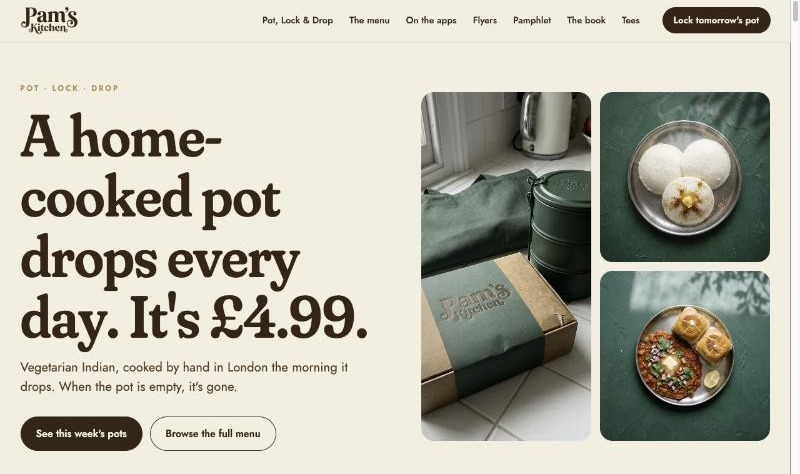
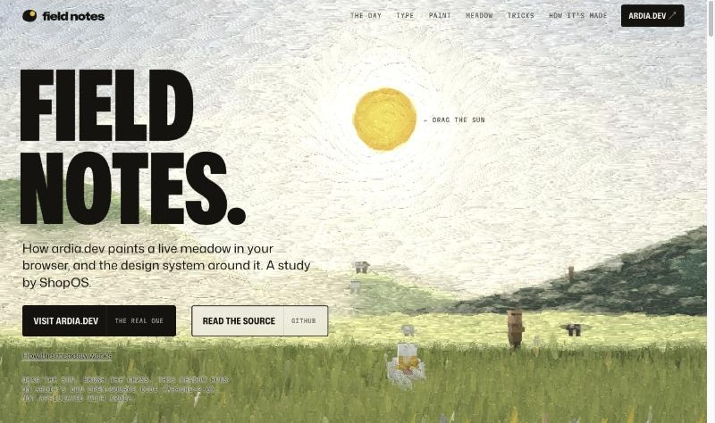
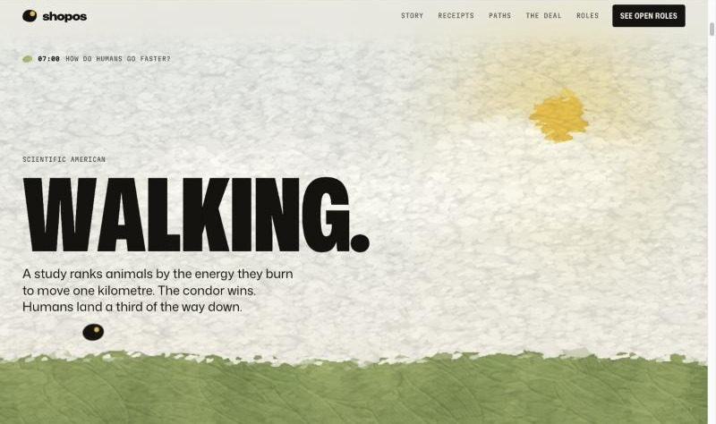
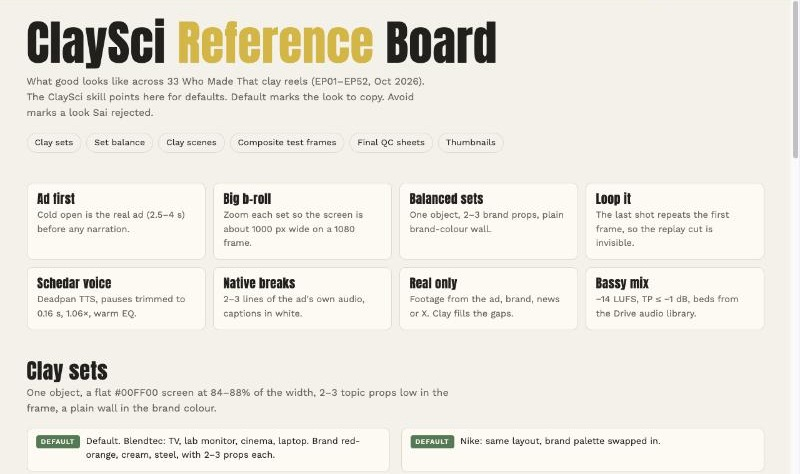

<div align="center">

# 🔬 reverse-engineered

### *ten things I pulled apart and rebuilt with Claude. screenshots, method, prompts.*

`design studies` · `ventures` · `brand kits` · `video kits` · `2026`

</div>

---

> 🔬 **what this is.**
> I love taking great things apart.
> A website. A brand. A sound. A reel style.
> Figure out *why* it works. Then build my own version.
> This repo collects ten of those builds.
> Each one gets a full write-up: screenshots, the method, a starter prompt, and lessons.
> Steal the method. Make your own. 🛠️

---

## 🖼️ the gallery

| | project | what it is |
|---|---|---|
| <a href="pams-kitchen/README.md"></a> | **[🍛 Pam's Kitchen](pams-kitchen/README.md)** | A homemade Indian dark kitchen, branded end to end. Menus, flyers, pamphlet, a coffee-table book, tees. |
| <a href="over-the-air/README.md"></a> | **[🌬️ Over the Air](over-the-air/README.md)** | A car perfume brand. Product films, a pull-to-start ritual, and a full brand book. |
| <a href="ardia-field-notes/README.md"></a> | **[🎨 Ardia Field Notes](ardia-field-notes/README.md)** | A design study of a painted, time-of-day site. Palettes, a paint kit, six tricks, nine passes. |
| <a href="sloosh-apple-dna/README.md"></a> | **[🍎 Sloosh × Apple DNA](sloosh-apple-dna/README.md)** | Apple's interface habits, borrowed for a creative tool. Bento that opens from where it sat. |
| <a href="sloosh-sound-sheet/README.md"></a> | **[🔊 Sloosh Sound Sheet](sloosh-sound-sheet/README.md)** | 18 UI sounds, made in code. Each play a little different. Never stamped. |
| <a href="twin-cut/README.md"></a> | **[✂️ Twin Cut](twin-cut/README.md)** | A two-track video trimmer. Original and remake, side by side, one trim. |
| <a href="shopos-careers/README.md"></a> | **[🌅 ShopOS Careers](shopos-careers/README.md)** | A careers page told as one painted day, 7am to 8pm. Ten open roles at the end. |
| <a href="4lunches-voice-research/README.md"></a> | **[🎙️ 4Lunches Voice Research](4lunches-voice-research/README.md)** | Customers talk, in their own language. Two skins: 8-bit and voice. |
| <a href="5aitec-phone/README.md"></a> | **[📱 5aitec, the phone](5aitec-phone/README.md)** | My personal site, as a phone. Lock screen, notifications, apps. |
| <a href="reel-kits/README.md"></a> | **[🎬 Reel Kits](reel-kits/README.md)** | Three kits for short video: clay, chalk, cinema. Boards, rules, files. |

---

## 🧭 the method

Every project followed the same loop.

```
   🔬 REVERSE-ENGINEER ANYTHING

   1. 👀 COLLECT     find the thing that makes you go "ooh"
   2. ⏸️ PAUSE       screenshot it, section by section
   3. 📝 NAME        write each part's one job
   4. 🔁 PATTERN     what repeats? that's a rule
   5. ✋ STRIP       keep the habits, drop the pixels
   6. 🛠️ REBUILD     your content, your look, the same jobs
   7. 🧪 COMPARE     side by side. fix what's off
   8. 📄 SAVE        write it as a file you can reuse
```

Step 5 is the important one.
We borrow **habits**, never assets.
No logos. No copied art. No lifted copy.
The lessons travel. The pixels stay home. ✋

Step 8 is the one people skip.
A teardown that ends as a page is nice.
One that ends as a skill file is useful forever. 📄

---

## 📖 how each write-up is laid out

```
   📄 EVERY ARTICLE

   🖼️ hero shot + tags
   💬 "what this is", in one breath
   📍 a map of the sections
   🧠 the idea, the build, the details
   🧭 what we reverse-engineered
   🛠️ how to make your own + a 🤖 starter prompt
   🚀 possibilities
   📚 lessons
```

About 2,000 words each.
Casual. Short sentences. Lots of ASCII.
Read one in ten minutes.

---

## ⚖️ credits and care

- **Inspiration is credited** in each article. Where a study runs on someone's open-source code, it says so.
- **No borrowed assets.** Habits and ideas only.
- **Privacy first.** Phone numbers and colleague names are blurred in screenshots.
- **Demo data is labelled.** Mock studies are clearly mocks.
- **Public-safe only.** Client work, deals and people pages are left out on purpose.

---

## 🔗 more from me

- 🌐 [5aitec.com](https://5aitec.com)
- 🏃 [GitHub Run](https://github.com/saitec/github-run): one open-source fix and one insight a day
- 👋 [saitec](https://github.com/saitec)

---

<div align="center">

```
      👀 → ⏸️ → 📝 → 🔁 → ✋ → 🛠️ → 🧪 → 📄
       take it apart. learn why. build your own.
```

*by [sai](https://5aitec.com) · made with Claude*

</div>
