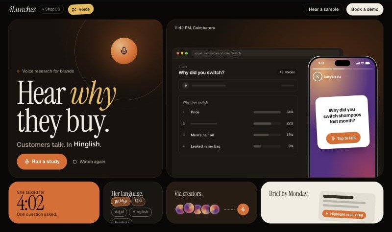
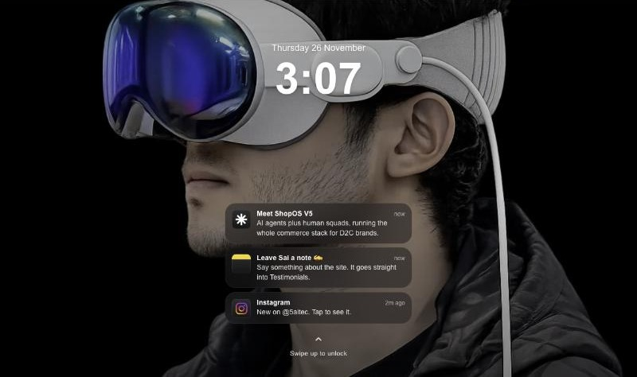

# 🧪 research studies

### *three small studies. voice research, a phone-style site, and video kits.*

`research` · `design studies` · `notes` · `2026`

---

> 🧪 **what this is.**
> a notebook of smaller research projects.
> each one asks a question, builds a test, and writes down what worked.
> screenshots, a method, a starter prompt and lessons in each.

---

## 🗂️ the studies

| | study | the question |
|---|---|---|
|  | **[🎙️ Voice-first customer research](voice-first-research/README.md)** | What do customers say when you let them talk, in their own language? |
|  | **[📱 A personal site as a phone OS](phone-os-portfolio/README.md)** | What if a portfolio used an interface everyone already knows? |
|  | **[🎬 Video style kits](video-style-kits/README.md)** | Can a board, some rules and a few files replace prompting from scratch? |

---

## 🔗 the bigger projects

Each has its own repo:

- 🍲 [ai-cloud-kitchen](https://github.com/saitec/ai-cloud-kitchen): a new model starts a cloud kitchen company on its own
- 🚗 [ai-car-perfume](https://github.com/saitec/ai-car-perfume): the same model launches a car perfume brand
- 🌾 [ai-browser-fork](https://github.com/saitec/ai-browser-fork): the same model studies a new Chrome browser fork
- 🍎💻 [mac-vs-pc-remix](https://github.com/saitec/mac-vs-pc-remix): remixing "I'm a Mac, I'm a PC" with AI video
- 🔊 [generative-sound-sheets](https://github.com/saitec/generative-sound-sheets): sound for the websites of the future
- 🚀 [ai-lab-careers-page](https://github.com/saitec/ai-lab-careers-page): a new kind of careers page for an AI lab
- 🍎 [apple-dna-design-study](https://github.com/saitec/apple-dna-design-study): Apple's habits, for a generative media app

---

*by [sai](https://5aitec.com) · made with Claude · more on [github.com/saitec](https://github.com/saitec)*

