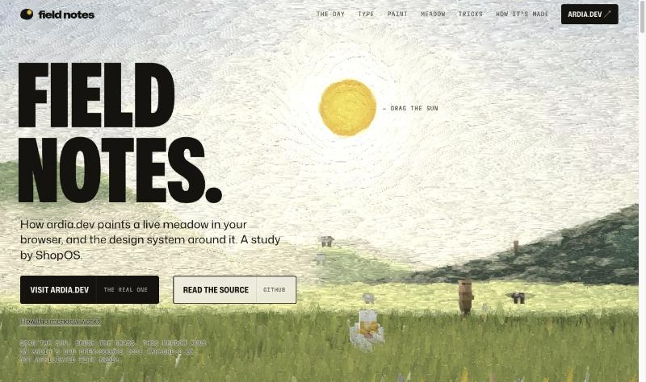
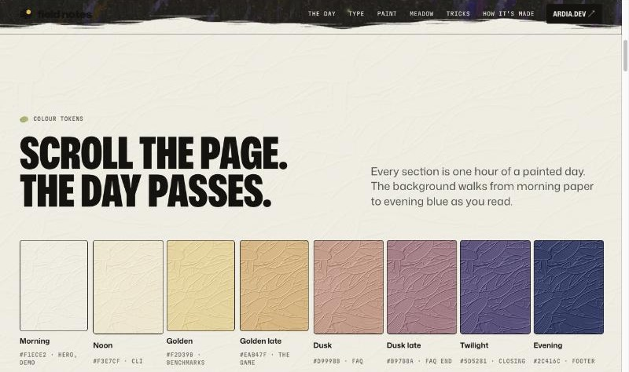
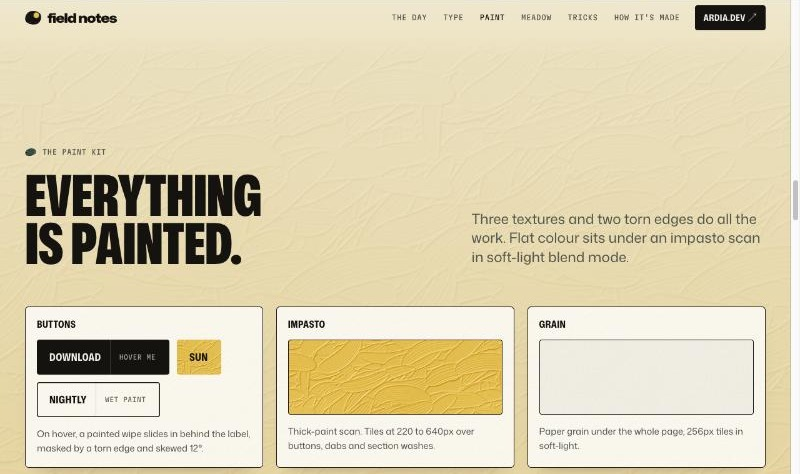
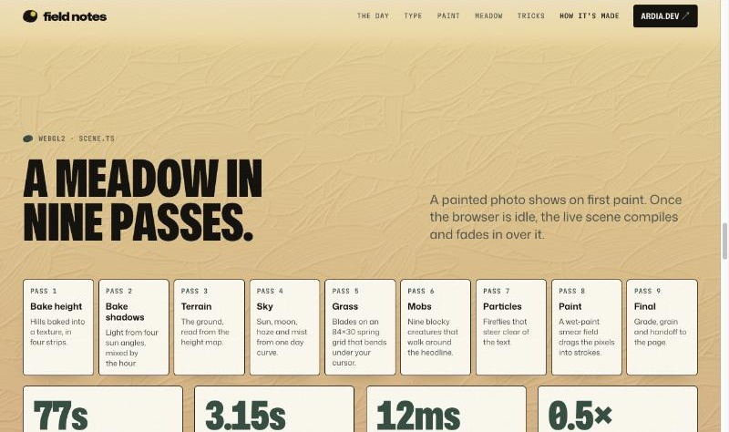
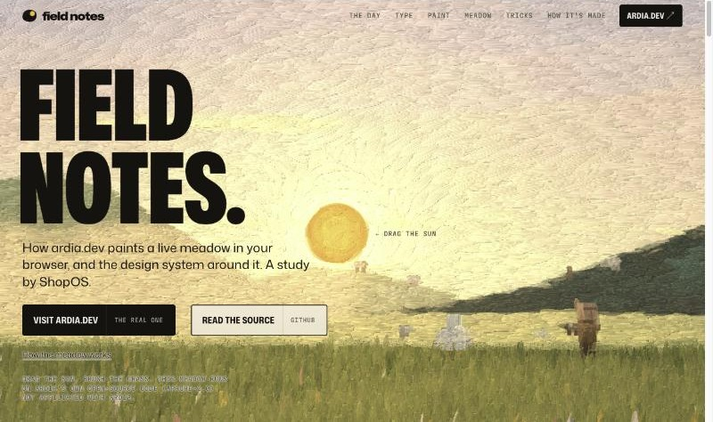
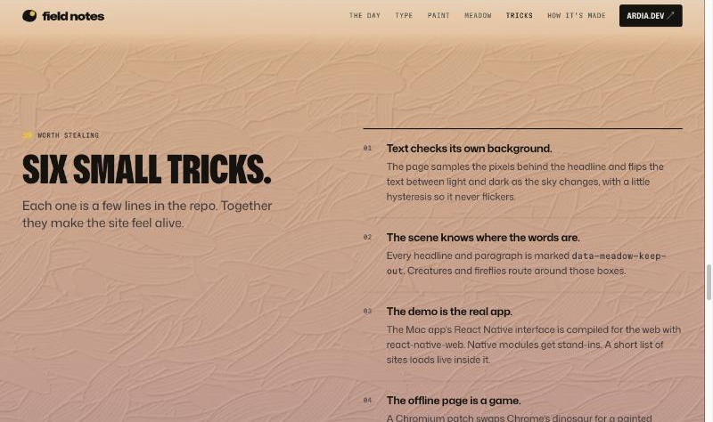
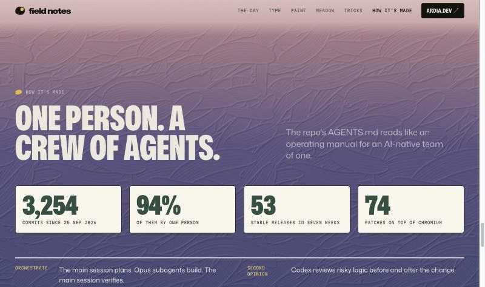

<div align="center">

# 🌾 Ardia Field Notes

### *a credited design study of ardia.dev. one painted day, in your browser.*



`reverse-engineered` · `design study` · `webgl` · `design tokens` · `nov 2026`

</div>

---

> 🔬 **what this is.**
> a study page i made with Claude after falling in love with [ardia.dev](https://ardia.dev).
> it pulls apart how the site works. colours. type. paint. the live meadow. the tricks.
> it runs on Ardia's own open-source code, credited, and links back to the real thing.
> this README walks through how we took it apart, what we learned, and what you can steal (politely).

---

## 📍 inside

```
 1. 🍿  the short version
 2. 😍  why ardia.dev stopped me mid-scroll
 3. 🧭  how we reverse-engineered it
 4. 🌅  the day: colour as time
 5. 🎨  the paint kit
 6. 🌾  the meadow in nine passes
 7. 🪄  six small tricks worth stealing
 8. 🤖  one person, a crew of agents
 9. 🛠️  how to make your own field notes
10. 🚀  where this went next
11. 📚  lessons
```

---

## 🍿 1. the short version

Some websites you read.
Some websites you *visit*.
ardia.dev is the second kind.

It paints a live meadow in your browser.
Grass bends under your cursor.
Little blocky creatures walk around the headline.
The sun moves as you scroll.
The whole page passes through one day, morning to night.

I wanted to know how.
So we took it apart, piece by piece.
Then we built a study page that explains it.
Using the site's own open-source code, credited.

That's Field Notes. 🌾

---

## 😍 2. why ardia.dev stopped me mid-scroll

I look at a lot of websites.
Hundreds a week, honestly.
Most blur together.
Gradient. Big headline. Three feature cards. Logos. Footer.

Then this one loads.
And it's a *painting*.
Not a photo of a painting. A live one.
Thick impasto paint. Brush strokes in the sky.
A sun you can drag. 🌞

```
   WHAT MOST SITES FEEL LIKE      WHAT ARDIA FEELS LIKE
   ┌──────────────────────┐       ┌──────────────────────┐
   │ ▓▓▓▓ gradient ▓▓▓▓▓▓ │       │ ☀️  ~~~ brushed sky ~~│
   │  BIG HEADLINE         │       │  FIELD NOTES.    🐑   │
   │  [card][card][card]   │       │ 🌾🌾🌾 grass that 🌾🌾 │
   │  logos logos logos    │       │ 🌾 moves when you 🌾🌾 │
   │  footer               │       │ 🌾🌾 touch it  🐄 🌾🌾 │
   └──────────────────────┘       └──────────────────────┘
        you skim                        you play
```

That difference is everything for a brand.
People remember things they *played with*.
They forget things they skimmed.

At ShopOS we build brand sites and creative for a living.
So when something this alive shows up,
I need to know how it's made.
Not to copy it.
To learn the *moves*.

---

## 🧭 3. how we reverse-engineered it

This was one of my "reverse engineer anything" sessions.
The method is simple. It works on almost any site.

```
   THE REVERSE-ENGINEER LOOP 🔁

   👀 1. LOOK        screenshot every section, every state
        │
        ▼
   🧾 2. INVENTORY   list colours, fonts, textures, motion, sounds
        │
        ▼
   🔎 3. READ        view source, the repo, AGENTS.md, commits
        │
        ▼
   🧪 4. ISOLATE     rebuild one piece at a time, prove you get it
        │
        ▼
   🗂️ 5. SYSTEMISE   turn the pieces into tokens + rules
        │
        ▼
   ✍️ 6. CREDIT      link the source, name the makers, never pass it off
```

**👀 Look.** We screenshot the site at every hour of its "day".
Morning hero. Noon. Golden hour. Dusk. Night.

**🧾 Inventory.** Every colour got a name and a hex.
Every font got checked. Every texture got described.

**🔎 Read.** Ardia's code is open source.
That's a gift. 🎁
We read the scene code, the repo's agent notes, the commit history.

**🧪 Isolate.** We rebuilt pieces one by one.
The day palette. The paint buttons. The grain.

**🗂️ Systemise.** Then we wrote it up as a design system.
Tokens. Rules. "Do this, not that."

**✍️ Credit.** Big buttons up top.
"Visit ardia.dev: the real one." "Read the source: GitHub."
This is a study, not a clone.
That line matters a lot to me. More on that later.

---

## 🌅 4. the day: colour as time



This is my favourite idea on the whole site.

> **Scroll the page. The day passes.**

Every section is one hour of a painted day.
The background walks from morning paper to evening blue as you read.

```
   ONE PAGE = ONE DAY 🌍

   ☀️ Morning     #F1ECE2   hero, demo
   🌤️ Noon        #F3E7CF   cli
   🌻 Golden      #F2D39B   benchmarks
   🍑 Golden late #EA8A7F   the game
   🌆 Dusk        #D9998B   faq
   🌸 Dusk late   #B97B8A   faq end
   🌌 Twilight    #5D5281   closing
   🌃 Evening     #2C416C   footer
```

Think about how clever that is.
Colour isn't decoration anymore.
It's a *clock*. ⏰
You always know where you are on the page
by how late the "day" looks.

And it does something emotional.
The top of the page feels fresh. Hopeful.
The bottom feels calm. Settled.
Like a good day, ending well.
That's storytelling with paint chips.

### 🧪 how you'd do it yourself

- Pick 6 to 8 colours that tell a story in order.
- Give each section one colour.
- Blend between them as you scroll.
- Make sure text stays readable on every one. (Trick #1 below handles that.)

You could do "seasons" for a fashion brand. 🍂
"Ocean depth" for a diving brand. 🌊
"Roast level" for a coffee brand. ☕
Same trick. New story.

---

## 🎨 5. the paint kit



> **Everything is painted.**

Three textures and two torn edges do all the work.
That's it. That's the whole kit.

```
   THE PAINT KIT 🖌️

   🟨 IMPASTO   thick-paint scan. tiles 220–640px.
                sits on buttons, dabs, section washes.

   📄 GRAIN     paper grain over the whole page.
                256px tile. soft-light blend.

   ✂️ TORN EDGE ×2   ripped paper edges for section joins.

   🎨 FLAT COLOUR    sits *under* the impasto.
                     the texture does the "paint" feeling.
```

The magic is the blend mode.
Flat colour underneath.
A real paint scan on top, in soft-light.
Your eye reads "paint".
Your browser just sees a colour and an image. 🧠

### 🔘 the buttons

Even the buttons are painted.
On hover, a painted wipe slides behind the label.
Masked by a torn edge.
Skewed 12 degrees, so it feels hand-done.

"DOWNLOAD — hover me."
"SUN." "NIGHTLY — wet paint." 😄

Tiny details. Big personality.
That's the lesson of this whole site.

---

## 🌾 6. the meadow in nine passes



Okay, the nerdy bit. 🤓
The live meadow is WebGL2.
It's drawn in nine passes, every frame.

```
   A MEADOW IN NINE PASSES 🌾

   PASS 1  🏔️ bake height     hills baked into a texture, in four strips
   PASS 2  🌗 bake shadows    light from 4 sun angles, mixed by the hour
   PASS 3  🟫 terrain         the ground, read from the height map
   PASS 4  🌤️ sky             sun, moon, haze and mist from one day curve
   PASS 5  🌾 grass           blades on an 84×30 spring grid, bends under your cursor
   PASS 6  🐑 mobs            nine blocky creatures that walk around the headline
   PASS 7  ✨ particles        fireflies that steer clear of the text
   PASS 8  🖌️ paint           a wet-paint smear field drags pixels into strokes
   PASS 9  🎞️ final           grade, grain, and handoff to the page
```

And the loading is smart too.
A painted *photo* shows on first paint.
Instant. No waiting.
Once the browser is idle, the live scene compiles quietly.
Then it fades in over the photo. ✨
You never see a loading spinner.
You never see a blank canvas.

That's a pattern every heavy site should copy.
**Show a picture of the thing. Then swap in the real thing.**



*Same hero, a few scrolls later. The sun has moved. The light went golden.*

---

## 🪄 7. six small tricks worth stealing



> **Each one is a few lines in the repo. Together they make the site feel alive.**

**01 · Text checks its own background.** 🔍
The page samples the pixels behind a headline.
It flips the text between light and dark as the sky changes.
With a little hysteresis, so it never flickers.

**02 · The scene knows where the words are.** 📍
Every headline is marked as a "keep-out" zone.
Creatures and fireflies walk *around* the words.
Nothing ever covers what you're reading.

**03 · The demo is the real app.** 📱
The product's real interface is compiled for the web.
So the "demo" on the site is the actual thing. Not a video.

**04 · The offline page is a game.** 🎮
Instead of Chrome's dinosaur, you get a painted one.
Even failure is on-brand.

**05 & 06** are smaller polish moves: timing, easing, little sounds and states.
Go read them on the study page. Better, read the repo. 🙂

```
   WHY TINY TRICKS MATTER 🧮

   1 trick   = "huh, cute"
   3 tricks  = "this team cares"
   6 tricks  = "i'm telling my friends about this site"
```

---

## 🤖 8. one person, a crew of agents



This part blew my mind.

> **One person. A crew of agents.**

The repo's agent notes read like an operating manual
for an AI-native team of one.

```
   ARDIA, BY THE NUMBERS (from the public repo) 📊

   3,254   commits since late september 2026
   94%     of them by one person
   53      stable releases in seven weeks
   74      patches on top of Chromium
```

How?
The main session plans.
Sub-agents build.
The main session verifies.
A second model reviews risky logic before and after the change.

That's the future of small teams, right there.
One person with taste.
A crew of agents with hands.
That's exactly how I think about ShopOS too.
Humans own the taste and the judgement.
Agents do the making.

---

## 🛠️ 9. how to make your own field notes

Want to do a study like this for a site you love?
The recipe is short.

### 📋 the steps

1. **Pick a site that made you stop.** Not one that's just "nice". One you *felt*.
2. **Screenshot every state.** Scroll positions. Hovers. Dark mode. Mobile. Errors.
3. **Make an inventory.** Colours (with hex), fonts, textures, motion, sounds.
4. **Read the source, if it's open.** Repo, docs, agent notes, commit history.
5. **Name the moves.** "Colour as time." "Show a photo, then swap." Short names stick.
6. **Rebuild one piece.** Prove you understand it.
7. **Write it up as a system.** Tokens, rules, do's and don'ts.
8. **Credit loudly.** Link the real site at the top. Name the makers. Respect the licence.

### 🤖 a prompt to start with

```
/reverse-engineer-anything https://<site-you-love>

Study this site. Screenshot every section and state.
List its colours (hex + where used), fonts, textures, motion and tricks.
Explain how the most impressive part works, step by step.
Then build a credited study page that teaches the system.
Link the original at the top. Do not pass it off as ours.
```

### ⚖️ the rules i follow

- ✅ Study the *ideas*. Ideas are free to learn from.
- ✅ Use open-source code only under its licence, with credit.
- ❌ Never copy logos, names, or a brand's actual art.
- ❌ Never ship a clone as if it's yours.
- 🙏 If you build something new from the lessons, say what inspired it.

---

## 🚀 10. where this went next

Studying is fun. Using it is better.

These lessons went straight into a ShopOS careers page concept.
One painted day. A pilot flying through the story.
Jetpacks for creative people. 🚀
It's in this repo too: [`shopos-careers`](../shopos-careers).

The big takeaways I carried over:
- **A page can have a clock.** Time of day became the story spine.
- **Texture beats gradient.** Real paint scans, not glossy blends.
- **Load a picture first.** Then the live thing.
- **Keep the words safe.** Nothing animated sits on top of text.

### 💡 more possibilities

```
   WHERE "COLOUR AS TIME" COULD GO ⏰

   🍷 a wine brand       vineyard from spring to harvest as you scroll
   🏃 a running app      sunrise run to sunset run
   ☕ a coffee brand      green bean → light → dark roast
   📚 a course site       chapter one (dawn) → graduation (night sky)
   🛍️ a d2c launch       the product's day: made, packed, shipped, unboxed
```

---

## 📚 11. lessons

**1. The best sites are places, not pages.** 🏞️
You don't read ardia.dev. You visit it.

**2. Colour can carry meaning.** 🌅
Make your palette *say* something. Time, depth, temperature.

**3. A few textures beat a hundred effects.** 🎨
Three textures, two edges. Done.

**4. Never block the words.** 📍
Fancy scenes still have to serve reading.

**5. Show the picture, then the real thing.** 🖼️
No blank canvases. No spinners.

**6. One person with agents can ship like a team.** 🤖
The numbers in that repo prove it.

**7. Credit is part of the craft.** 🙏
A study that hides its source is just a copy.
A study that celebrates it teaches everyone.

---

<div align="center">

**🙏 all credit to the maker of [ardia.dev](https://ardia.dev).**
this page is a study. go visit the real meadow. drag the sun.

*part of [reverse-engineered](../README.md) by [sai](https://5aitec.com) · made with Claude*

</div>
