<div align="center">

# 🚗 Over The Air

### *your car already updates over the air. now the cabin does too.*

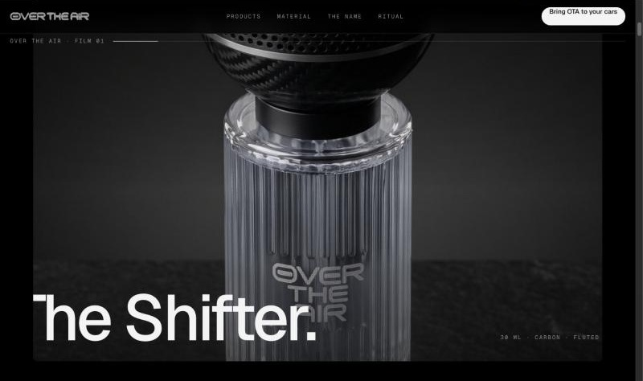

`brand from zero` · `car perfume` · `cinematic scroll site` · `brand book` · `oct 2026`

</div>

---

> 🌬️ **what this is.**
> Over The Air (OTA) is a car perfume venture i'm building.
> two objects: a scent that looks like a gear knob, and one that sits in your cupholder.
> this repo covers two things we built with Claude:
> a cinematic scroll website, and a full brand book traced from hand-drawn artwork.
> it's a walkthrough of how a physical product gets a world before it ever ships.

---

## 📍 inside

```
 1. 🍿  the short version
 2. 💡  why car perfume, why now
 3. 🏷️  the name
 4. 🎬  the website: a film you scroll
 5. 🧲  two objects, where your hand already goes
 6. 🫧  the ritual: pull to start
 7. 📘  the brand book
 8. 🌀  the logo: a car vent, traced
 9. 🎨  concrete, carbon and one tail light
10. 🛍️  applications: on everything you can put a vent on
11. 🛠️  how we built it
12. 🚀  possibilities
13. 📚  lessons
```

---

## 🍿 1. the short version

Car fresheners are… sad. 🌲
Cardboard trees. Plastic clips. Fake "new car" smell.
They live in the most-loved object many people own.
And they look like an afterthought.

OTA asks a simple question:
**what if a car scent looked like it belonged in the car?**

Carbon fibre. Brushed steel. Fluted glass.
Shaped like a gear knob.
Or sized for your cupholder.
A perfume, not a freshener.

Then we built its world:
a website that plays like a car film,
and a brand book with every rule written down.

---

## 💡 2. why car perfume, why now

A car is a little room you spend hours in.
Commutes. Road trips. Waiting in traffic. 🚦
For a lot of people, it's the only private space they get all day.

```
   THE CAR, AS A ROOM 🚗

   🎵 sound    → people spend a lot on speakers
   💡 light    → ambient LEDs are standard now
   🪑 touch    → leather, alcantara, heated seats
   👃 smell    → a cardboard tree. still. 😐
```

Every sense got an upgrade except smell.
That's the gap.

And cars changed too.
Modern cars get software updates "over the air".
New features overnight, without visiting a garage.
That phrase gave us the name. And the idea.
The car updates itself. Now the cabin can too. 🌬️

---

## 🏷️ 3. the name

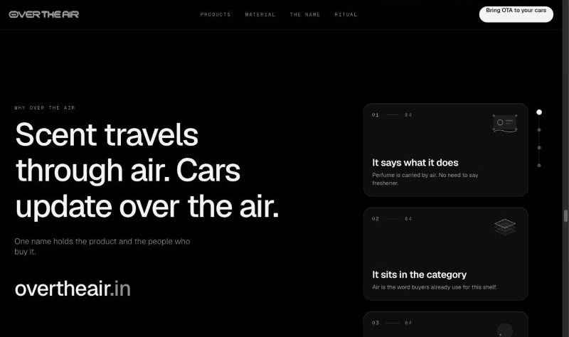

> **Scent travels through air. Cars update over the air.**
> *One name holds the product and the people who buy it.*

Why "Over The Air" works:

```
   01 · it says what it does       perfume is carried by air. no need to say "freshener".
   02 · it sits in the category    "air" is the word buyers already use for this shelf.
   03 · car people know the phrase OTA updates. instant insider nod. 😉
   04 · it shortens beautifully    OTA. three letters. looks great on a vent.
```

And the domain: **overtheair.in**.
Short. Clean. Says the country it starts in.

The best names do double duty.
This one names the *product* (it travels through air)
and the *customer* (people who know what OTA means).

---

## 🎬 4. the website: a film you scroll

The site opens like a car commercial.
Black screen. One product. Big words. Slow light.
It's labelled "Over The Air · Film 01".

As you scroll, it cuts between close-ups:

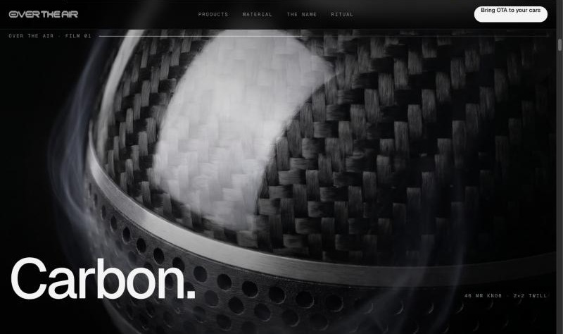

> **Carbon.** *46 mm knob · 2×2 twill.*

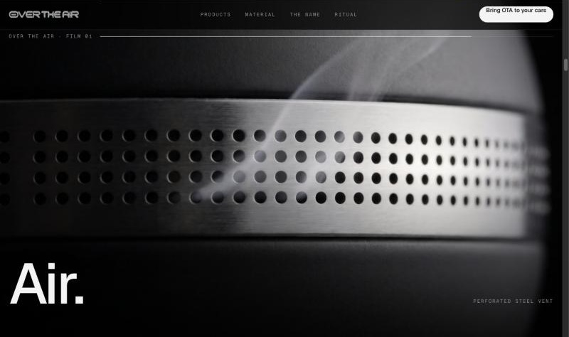

> **Air.** *Perforated steel vent.*

```
   THE FILM, SCENE BY SCENE 🎞️

   🎬 SCENE 1   The Shifter.   full product. fluted glass. carbon top.
   🎬 SCENE 2   Carbon.        macro on the weave. light sweeping across.
   🎬 SCENE 3   Air.           the steel vent. a wisp of scent drifting out.
   🎬 SCENE 4   ...            and on into the products, the name, the ritual.
```

One word per scene.
White type. Black world.
Each word is a *material*, not a feature.
Carbon. Air. Glass.
You learn what it's made of before you learn what it does.
That's how luxury talks. 🖤

### 🎥 why a film instead of a normal page

Car people love car films.
The reveal. The slow pan across a headlight.
The macro on stitching.
We borrowed that language on purpose.
So a car person feels at home in two seconds.

---

## 🧲 5. two objects, where your hand already goes

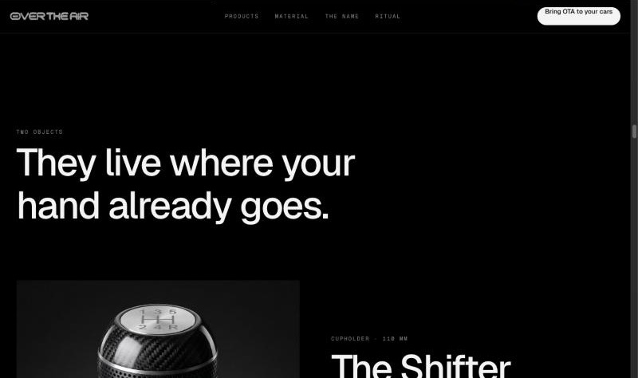

> **They live where your hand already goes.**

Two products. Two places you already touch.

```
   🕹️ THE SHIFTER     a gear-knob-shaped scent
                      sits in the cupholder · 110 mm tall
                      carbon top · fluted glass · steel vent

   🥤 THE CUP          a cupholder scent
                      a little taller than a can
```

This is the clever bit of the product thinking.
Fresheners usually hang off a mirror or clip to a vent.
OTA goes where your hand *already* rests.
You touch it without thinking.
So the scent becomes a habit. ✋

The gear-knob shape is a wink, too.
More and more cars don't have a real gear stick anymore.
OTA gives you one back. As a perfume. 😄

---

## 🫧 6. the ritual: pull to start

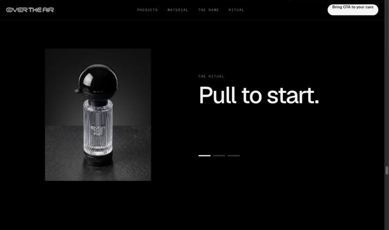

> **Pull to start.**

Every good product has a ritual.
Opening an iPhone box. Popping a champagne cork. 🍾
OTA's is "pull to start".
You pull the knob up. The scent opens.
A tiny moment that feels like starting the car.

The site shows it in three steps, like a little slideshow.
Pull. Release. Breathe.

Rituals matter because they make a product feel *alive*.
And they're easy to film. Which makes them easy to share. 📱

---

## 📘 7. the brand book

The website is the show.
The brand book is the rules.

```
   OTA BRAND BOOK, CONTENTS 📘

   💭 idea          🌀 logo         🎨 colour       🔤 type
   🟰 slats         🛍️ applications 📸 imagery      🧴 product
   🏷️ names         🗣️ voice        📁 files
```

It's a long vertical page, dark by default.
Everything a designer, printer or partner needs.
Download the files. Follow the rules. Done.

The big change between versions was brave:
we *retired* things.
A lamp-counter wordmark. Fluted glass as a graphic device.
Five headlight drawings.
All gone.
**The slat is the device now.**

Cutting is a design skill.
Fewer ideas, done better. ✂️

---

## 🌀 8. the logo: a car vent, traced

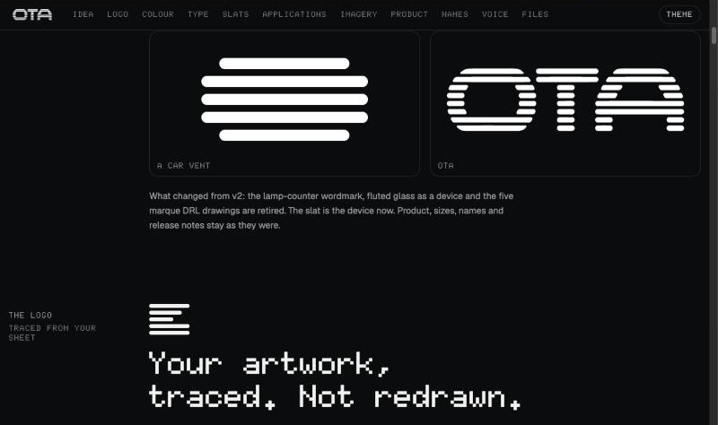

> **Your artwork, traced. Not redrawn.**

The logo started as a hand sketch.
A car vent. Horizontal slats.
Then the letters O, T, A built from the same slats.

```
   FROM VENT TO WORDMARK 🌀

   ═════════            ═══  ═════  ═══
   ═══════════   ──►   ═   ═   ═   ═   ═
   ═══════════         ═   ═   ═   ═════
   ═════════            ═══    ═   ═   ═
   a car vent              O    T    A
```

The most important rule in the book:
**traced, not redrawn.**
We kept the founder's original artwork exactly.
Every slat. Every gap.
Then cleaned it into vectors.

Why that matters:
When AI or a designer "improves" a sketch,
it often loses the soul.
The wobble. The specific spacing. The thing that made it *yours*.
Tracing keeps it.

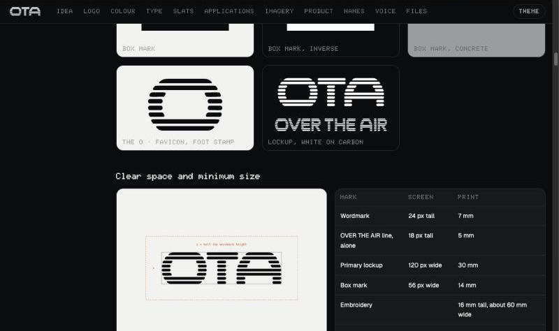

The marks:
- **Wordmark.** OTA in slats.
- **Box mark.** OTA in a solid block. Inverse version too.
- **The O.** Alone, as a favicon and a little foot stamp.
- **Lockup.** OTA plus "OVER THE AIR" on carbon.

And proper rules:
clear space is half the wordmark height.
Minimum sizes for screen, print and even embroidery.
Wordmark: 24 px on screen, 7 mm in print.

### 🎞️ motion

Slats arrive from the left, one row at a time.
40 ms between rows. 480 ms travel.
A custom ease curve.
One orange streak crosses in 900 ms, once.
Like a tail light passing at night. 🚗💨

---

## 🎨 9. concrete, carbon and one tail light

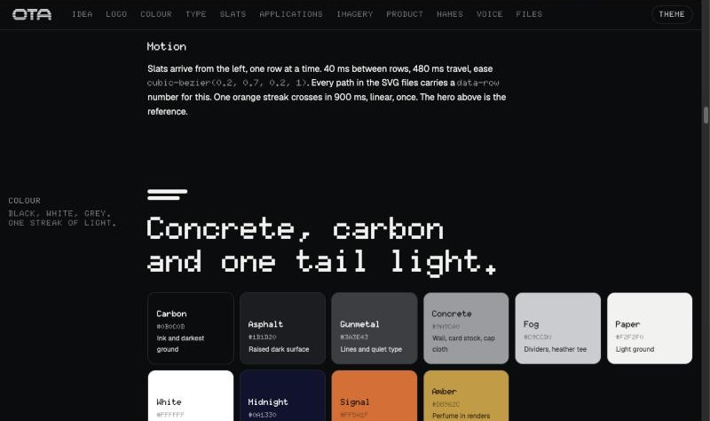

> **Concrete, carbon and one tail light.**

The palette is a car park at night. 🌃

```
   OTA COLOURS 🎨

   ⬛ Carbon     #0B0C0D   ink and darkest ground
   ◼️ Asphalt    #1B1D20   raised dark surface
   🔘 Gunmetal   #3A3E43   lines and quiet type
   🩶 Concrete   #9A9C9A   wall, card stock, cap cloth
   ⚪ Fog        #C9CCD0   dividers, heather tee
   🤍 Paper      #F2F2F0   light ground
   ⬜ White      #FFFFFF
   🌑 Midnight   #0A1330
   🟧 Signal     #FF5A1F   the one tail light
   🟨 Amber      #D8962C   perfume in renders
```

Mostly greys.
One orange.
Used rarely. Like a tail light.
That restraint is what makes it feel premium.
Loud brands shout everywhere.
Premium brands whisper, then flash once. 🔶

---

## 🛍️ 10. applications: on everything you can put a vent on

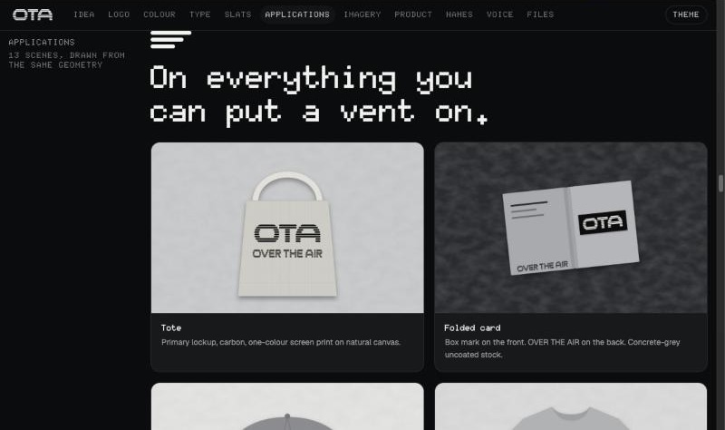

> **On everything you can put a vent on.**

Thirteen scenes, drawn from the same geometry:

```
   👜 tote              primary lockup, carbon, screen print on canvas
   💌 folded card       box mark front, OVER THE AIR on the back
   🧢 cap               embroidered O
   👕 tee               slats across the chest
   📦 box               the product's home
   🏷️ hang tag          for retail
   ...and more
```

Every application uses the same slat geometry.
So everything looks like one family.
Even a tote bag says "car" without showing a car. 🚗

### 🧴 the product, at real scale

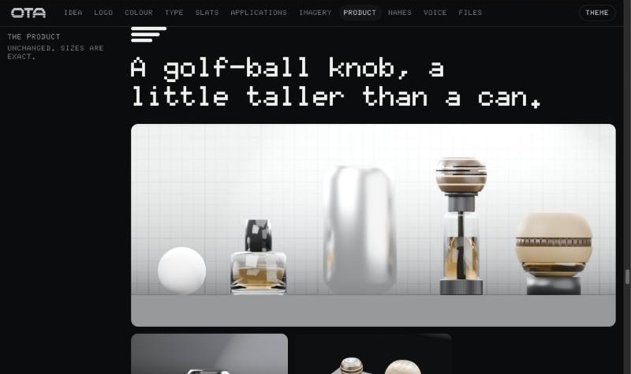

> **A golf-ball knob, a little taller than a can.**

This might be the most useful slide in the book.
The products, shown next to a golf ball and a soda can.
Exact sizes. No guessing.
Every render, every ad, every mockup uses this as truth.

Why it matters:
AI image tools love to make products *huge*.
A tiny perfume becomes a lamp. 😅
A scale reference fixes that forever.

---

## 🔍 what we reverse-engineered

OTA's site isn't copied from one place.
It borrows the *grammar* of three worlds.

```
   THE THREE REFERENCES 🔍

   🚘 car launch films      slow pans, macro on materials, one word on black
   🍎 premium product pages one object per screen, sticky scroll, quiet type
   🏎️ car interiors          carbon weave, knurled steel, perforated leather
```

From car films we took the **pacing**.
One shot. Hold. Cut. Never rushed.

From premium product pages we took the **structure**.
One object per screen. The scroll is the timeline.
Text stays out of the product's way.

From car interiors we took the **materials**.
Every surface on the site is something you'd touch in a nice car.

The trick is to study the *moves*, not the assets.
We never used a car brand's footage, logo or type.
We used how they *think*.
That's the difference between learning and copying. 🧠

---

## 🛠️ 11. how we built it

```
   THE OTA BUILD 🛠️

   ✏️ hand sketches of the vent logo
        │  traced, not redrawn
        ▼
   🧴 3D product renders (shifter + cup) at true scale
        │
        ▼
   🎬 macro shots: carbon, steel, glass, scent wisps
        │
        ▼
   🌐 the film site: one word per scene, scroll-driven
        │
        ▼
   📘 the brand book: tokens, marks, rules, files
        │
        ▼
   🛍️ applications: 13 scenes from one geometry
```

### 🔑 the rules we followed

- **Real scale, always.** Every image checked against the golf-ball slide.
- **Materials first.** Carbon, steel, glass. Name them, show them close.
- **One accent colour.** Signal orange, rarely.
- **Keep the founder's hand.** Trace sketches. Don't "improve" them away.
- **Retire ideas bravely.** Three versions in, we cut half the devices.

### 🤖 a starter prompt for product macros

```
Extreme macro of [material: carbon fibre twill / perforated brushed
steel / fluted glass] on a car-scent object, black studio background,
one hard rim light sweeping across, a faint wisp of vapour. Shot on a
Hasselblad with a macro lens, razor-sharp texture, no reflections of
the camera, neutral colour, cinematic, minimal.
```

---

## 🚀 12. possibilities

```
   WHERE OTA COULD GO 🚗

   🔄 refills by subscription     "your cabin updates every month" (OTA, literally)
   🎛️ scent "firmware"            new seasonal scents, named like software versions
   🤝 car brand collabs           a scent per marque, sold at the dealership
   🏁 motorsport drops            limited scents for race weekends
   📱 an app                      pick your scent schedule. morning drive vs night drive.
   🏢 fleet & taxis               a calm cabin as a premium ride feature
   🎁 the "new car" gift          the first thing in a brand-new car
```

The subscription one is my favourite.
"Your cabin updates over the air."
Version numbers for scents. v1.2: Cedar Night. 😄
The name practically writes the business model.

---

## 📚 13. lessons

**1. Put it where the hand already goes.** ✋
The best placement is a habit you already have.

**2. Name things twice.** 🏷️
A name that describes the product *and* winks at the buyer is gold.

**3. Talk in materials.** 🧱
Carbon. Air. Glass. Materials sound premium. Features sound cheap.

**4. One accent, used rarely.** 🔶
Restraint reads as luxury.

**5. Trace, don't redraw.** ✏️
Keep the founder's hand in the mark.

**6. Show true scale.** 📏
Especially when AI makes your images.

**7. Cut bravely.** ✂️
Version three got better by losing half of version two.

**8. Build the world before the product ships.** 🌍
A film, a book and a name make a prototype feel inevitable.

---

<div align="center">

```
   ═══  ═════  ═══
  ═   ═   ═   ═   ═      over the air.
   ═══    ═   ═   ═      the cabin updates too. 🌬️
```

*part of [reverse-engineered](../README.md) by [sai](https://5aitec.com) · made with Claude*

</div>
