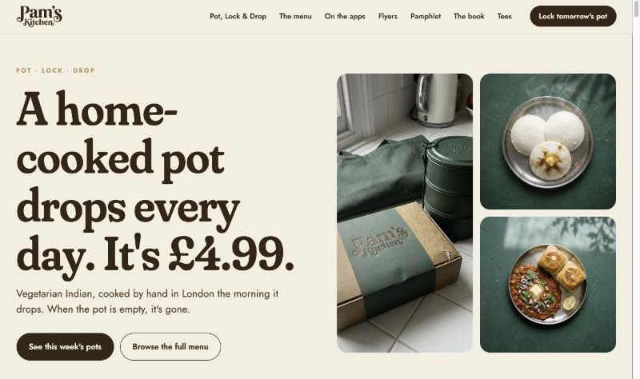
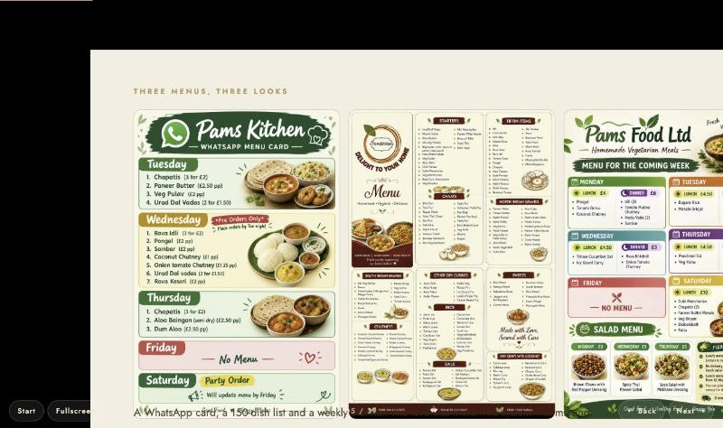
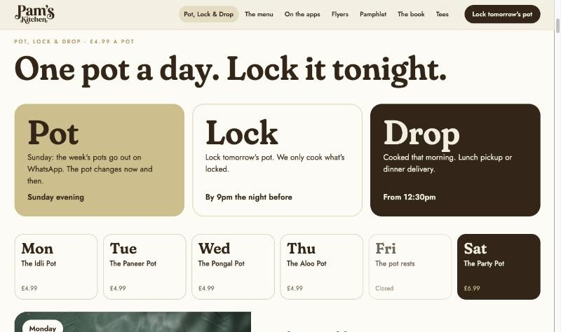
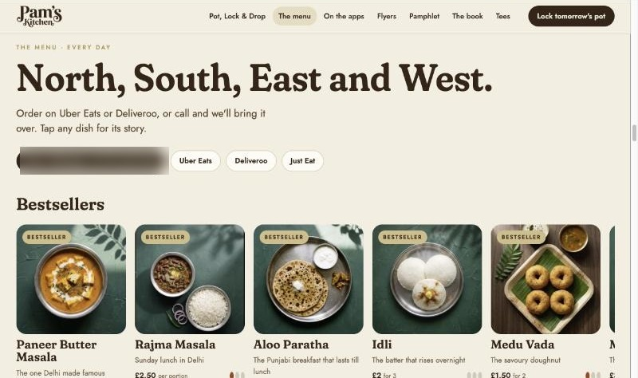
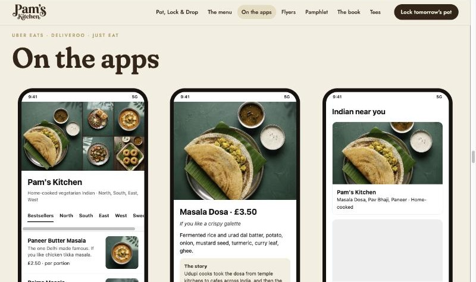
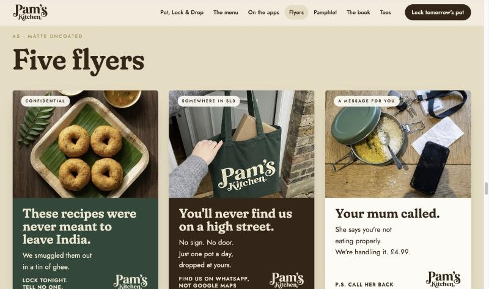
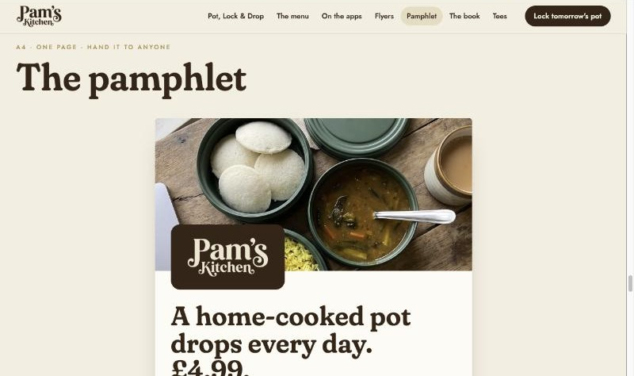
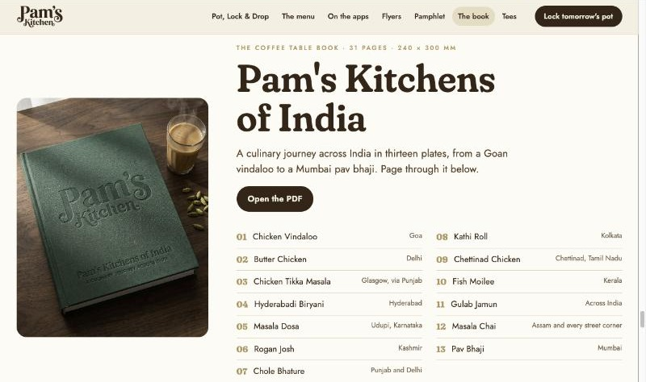
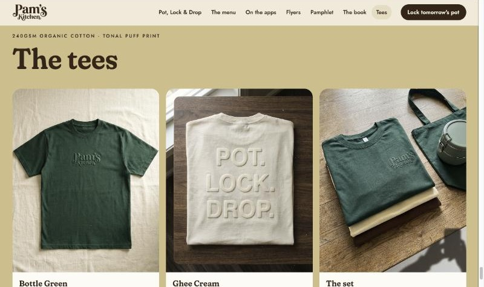

<div align="center">

# 🍲 Pam's Kitchen

### *a home-cooked pot drops every day. it's £4.99.*



`brand from zero` · `dark kitchen` · `london` · `website + print + merch + book` · `oct 2026`

</div>

---

> 🍛 **what this is.**
> Pam's Kitchen is a homemade Indian dark-kitchen concept in London that i helped kickstart.
> it started as three messy WhatsApp menus. it ended as a full brand:
> a website, a weekly ritual, app listings, five flyers, a pamphlet, a coffee-table book and tees.
> every image you see was made with AI tools, art-directed by hand.
> this README is the full walkthrough. how a tiny food idea becomes a brand you'd queue for.

---

## 📍 the menu (of this article)

```
 1. 🍿  the short version
 2. 📱  before: three menus, three looks
 3. 💡  the one idea that fixed everything
 4. 🌐  the website, section by section
 5. 🗓️  pot · lock · drop: the weekly ritual
 6. 🍛  the menu that tells stories
 7. 📲  on the apps
 8. 📰  five flyers
 9. 📄  the pamphlet
10. 📖  the coffee-table book
11. 👕  the tees
12. 🛠️  how we made every image
13. 🚀  possibilities
14. 📚  lessons
```

---

## 🍿 1. the short version

A home cook in London makes great vegetarian Indian food.
People order on WhatsApp.
The menus were chaotic.
The brand didn't exist yet.

We built one.
Not just a logo.
A whole *way of ordering*.
One pot a day. Lock it the night before. It drops the next day.

Then we dressed that idea up everywhere:
web, apps, paper, a book, even t-shirts. 🍲👕📖

---

## 📱 2. before: three menus, three looks



This is where it started.
Three menus. Three completely different looks.

```
   THE "BEFORE" 😵

   📱 a WhatsApp menu card       cartoon fonts, clip-art bowls
   📜 a 150-dish list            every dish ever, tiny text
   📅 a weekly planner menu      tables, colours, prices everywhere
```

Each one worked, kind of.
Together they said: "we don't know who we are yet."

And that's normal!
Every small food business starts like this.
You cook first. You brand later.
The food was already good.
The *wrapper* was the problem.

The hardest thing in the "before" was the 150-dish list.
Too many choices.
Customers freeze. Kitchens burn out.
That list told us what to fix first.

---

## 💡 3. the one idea that fixed everything

We stopped asking "what should the logo look like?"
We asked "how should ordering *feel*?"

The answer came fast:

> **One pot a day. Lock it tonight.**

```
   THE BIG SIMPLIFICATION ✂️

   BEFORE                         AFTER
   150 dishes, any day      ──►   1 pot per day
   order whenever            ──►   lock by 9pm the night before
   cook everything           ──►   cook only what's locked
   chaos                     ──►   a ritual 🙏
```

Why it works:
- **For customers:** zero decision fatigue. Just "do I want tomorrow's pot?"
- **For the kitchen:** no waste. You cook what's locked. Nothing more.
- **For the brand:** scarcity feels special. "When the pot is empty, it's gone."

That one sentence became the whole brand.
Every page, flyer and tee repeats it in some way.

---

## 🌐 4. the website, section by section

The site has seven sections.
Each one is a different thing the brand needs.

```
   PAM'S KITCHEN, THE SITE 🗺️

   🏠 hero              "a home-cooked pot drops every day. it's £4.99."
   🗓️ pot, lock & drop  the weekly ritual, day by day
   🍛 the menu          north, south, east and west, with stories
   📲 on the apps       how it looks on the delivery apps
   📰 flyers            five print ads with attitude
   📄 pamphlet          one A4 page to hand to anyone
   📖 the book          a 31-page coffee-table book
   👕 tees              merch, because why not
```

### 🏠 the hero

Look at the hero again (top of this page).
Big warm serif headline.
Bottle-green and ghee-cream colours.
Real-looking food photos: idli, pav bhaji, a steel tiffin.
A kraft box with a green band.

The price is *in the headline*.
"It's £4.99."
Most food brands hide price.
We put it front and centre.
Because cheap-but-homemade *is* the pitch. 💷

Two buttons. Nothing else:
"See this week's pots." "Browse the full menu."

---

## 🗓️ 5. pot · lock · drop: the weekly ritual



> **One pot a day. Lock it tonight.**

Three big cards explain the whole system:

```
   🫕 POT      Sunday: the week's pots go out on WhatsApp.
                The pot changes now and then.          → Sunday evening

   🔒 LOCK     Lock tomorrow's pot.
                We only cook what's locked.            → by 9pm the night before

   🛵 DROP     Cooked that morning.
                Lunch pickup or dinner delivery.       → from 12:30pm
```

Then the week, day by day:

```
   MON  🥟 The Idli Pot      £4.99
   TUE  🧀 The Paneer Pot    £4.99
   WED  🍚 The Pongal Pot    £4.99
   THU  🥔 The Aloo Pot      £4.99
   FRI  😴 The pot rests     closed
   SAT  🎉 The Party Pot     £6.99
```

"The pot rests" on Friday. 😄
Little human touches like that make it feel real.
Like a person runs this. Because a person does.

---

## 🍛 6. the menu that tells stories



> **North, South, East and West.**

The full menu still exists.
But it's organised now.
By region. With bestsellers on top.

And every dish has a one-line story:

```
   🧈 Paneer Butter Masala   "the one Delhi made famous"
   🫘 Rajma Masala           "Sunday lunch in Delhi"
   🫓 Aloo Paratha           "the Punjabi breakfast that lasts till lunch"
   ⚪ Idli                   "the batter that rises overnight"
   🍩 Medu Vada              "the savoury doughnut"
```

That's the trick.
A dish name tells you *what* it is.
A one-line story tells you *why you want it*.
"The savoury doughnut" sells medu vada to a Londoner in four words. 🍩

Tap any dish for its full story.
Where it's from. What's in it. How it's eaten back home.

*(We blurred the phone number in this screenshot. Real business numbers don't belong in a public repo.)*

---

## 📲 7. on the apps



Most orders for a dark kitchen come through delivery apps.
So we designed how Pam's Kitchen *looks inside them*.

```
   THREE PHONE SCREENS 📱📱📱

   1. the store page    hero grid of dishes, tabs: north, south, east, west
   2. a dish page       big photo, price, "if you like a crispy galette" 😄
   3. a search result   how Pam's shows up in "Indian near you"
```

Look at the dosa page:
**Masala Dosa · £3.50**
*"If you like a crispy galette."*

That line is pure gold for London.
It translates an Indian dish into a word Londoners already love.
No explaining. Just a bridge. 🌉

The photos are consistent everywhere.
Same green backdrop. Same steel plates. Same light.
So in a list of 50 restaurants, Pam's looks like *one* brand.
That consistency is half of standing out.

---

## 📰 8. five flyers



> **A5 · matte uncoated.**

This is my favourite part. 😍
Five flyers. Each with a cheeky story.

```
   THE FLYERS 📰

   🤫 CONFIDENTIAL
      "These recipes were never meant to leave India."
      "We smuggled them out in a tin of ghee."
      → lock tonight. tell no one.

   📍 SOMEWHERE IN SL3
      "You'll never find us on a high street."
      "No sign. No door. Just one pot a day, dropped at yours."
      → find us on WhatsApp, not Google Maps

   📞 A MESSAGE FOR YOU
      "Your mum called."
      "She says you're not eating properly. We're handling it. £4.99."
      → p.s. call her back
```

(Plus two more on the site.)

Why these work:
- **They're stories, not ads.** You read them like a note from a friend.
- **They lean into the "secret" vibe.** Dark kitchen = no shopfront. So we made that the *charm*.
- **The mum one.** 😂 Every Indian student in London has had that call. Instant connection.

"P.S. call her back" at the bottom.
That's the line that makes people screenshot it.
And screenshots are free marketing.

---

## 📄 9. the pamphlet



> **A4 · one page · hand it to anyone.**

One page. Everything you need.
Logo. A hero photo of idli and sambar in a steel tiffin.
The headline again: "A home-cooked pot drops every day. £4.99."
Then how to order, the week, and a QR code.

It's designed for one job:
hand it to a neighbour, a colleague, a friend.
They should understand the whole thing in ten seconds. ⏱️

Print still works for local food.
Letterboxes. Office kitchens. Gurdwara and temple boards.
Community notice boards.
A good one-pager beats a fancy website for this kind of reach.

---

## 📖 10. the coffee-table book



> **Pam's Kitchens of India.**
> *A culinary journey across India in thirteen plates.*

This is where it got fun. 📚
A 31-page coffee-table book. 240 × 300 mm.
Thirteen dishes. Thirteen places.

```
   THIRTEEN PLATES 🗺️

   01 🌶️ Chicken Vindaloo       Goa
   02 🧈 Butter Chicken          Delhi
   03 🍗 Chicken Tikka Masala    Glasgow, via Punjab   ← 😄
   04 🍚 Hyderabadi Biryani      Hyderabad
   05 🥞 Masala Dosa             Udupi, Karnataka
   06 🍖 Rogan Josh              Kashmir
   07 🫓 Chole Bhature           Punjab and Delhi
   08 🌯 Kathi Roll              Kolkata
   09 🔥 Chettinad Chicken       Chettinad, Tamil Nadu
   10 🐟 Fish Moilee             Kerala
   11 🍡 Gulab Jamun             Across India
   12 ☕ Masala Chai             Assam and every street corner
   13 🍞 Pav Bhaji               Mumbai
```

"Chicken Tikka Masala · Glasgow, via Punjab." 😂
That's the voice. Playful. True. A little nerdy.

Why make a book for a dark kitchen?
- It turns a food business into a **culture brand**.
- It's a gift. People give it, post it, leave it on tables.
- It's proof of taste. "These people really know Indian food."
- It's a press magnet. Journalists love a book.

The cover is embossed green cloth.
Shot next to a glass of chai and cardamom pods.
Pure mood. ☕

---

## 👕 11. the tees



> **240gsm organic cotton · tonal puff print.**

Three tees:
- 🟢 **Bottle Green** with a tonal Pam's Kitchen logo.
- 🤍 **Ghee Cream** with "POT. LOCK. DROP." puffed on the back.
- 📦 **The Set**, folded, with the steel tiffin and tote.

Tonal puff print means the print is the same colour as the shirt.
Raised, not loud.
It's merch you'd actually wear. Not a promo freebie.

Why merch for a tiny kitchen?
Because people who love a local food spot *want to show it*.
Give them a way.
Every tee on the street is a walking ad. 🚶

---

## 🛠️ 12. how we made every image

Every photo on this page is AI-generated.
Food, packaging, tees, book, flyers.
Art-directed shot by shot.

```
   THE IMAGE PIPELINE 📸

   ✍️ 1. write the look      bottle green, ghee cream, steel, wood, soft daylight
        │
        ▼
   🎨 2. hero frames first    lock 3–4 "golden" images that define the brand
        │
        ▼
   🔁 3. reuse as references  every new image uses the golden ones as refs
        │
        ▼
   🍛 4. dish by dish          same backdrop, same plate, same light, new dish
        │
        ▼
   📦 5. objects               box, tiffin, tote, book, tees: same palette
        │
        ▼
   👀 6. human QC              kill anything that looks fake, plastic or off-brand
```

### 🔑 the rules that made it look real

- **One backdrop colour.** Deep bottle green. Always.
- **Real materials.** Steel thalis. Banana leaves. Kraft paper. Wood.
- **Daylight, never studio flash.** Soft window light from one side.
- **Imperfection.** Crumbs. A drip of sambar. A crease in the paper.
- **No yellow tint.** Indian food photos often go muddy yellow. We fought that hard.
- **Hasselblad feel.** Shallow depth. Sharp food. Soft background.

### 🤖 a starter prompt

```
Overhead photo of [dish] on a steel thali, on a deep bottle-green
textured surface. Soft daylight from the left. A small bowl of
[side] and fresh [garnish]. Real crumbs and texture, slight
imperfection. Sharp focus on the food. Neutral colour, no yellow
tint. Shot on a Hasselblad, natural, appetising, editorial.
```

Swap the dish. Keep everything else.
That's how 30+ images still feel like one brand.

### 📦 what got made

```
   📸 ~15 dish photos      📦 box + tiffin + tote
   📱 3 app screens        📰 5 flyers
   📄 1 pamphlet           📖 1 book cover + 13 plates
   👕 3 tees               🎞️ a 39-slide brand film showing the journey
```

All of it, from a WhatsApp menu, in a few focused sessions.
Five years ago that's a branding agency, a photographer, a food stylist,
a print designer and a month.

---

## 🚀 13. possibilities

What else could this become?

```
   WHERE PAM'S COULD GO NEXT 🍲

   🗓️ subscriptions       "the week's pots" as a weekly plan
   🎁 gift pots            send a pot to a friend who's "not eating properly" 😄
   🏢 office drops         a pot for every desk, every friday
   📚 the book, for sale   print-on-demand, signed by the cook
   🎥 short videos         one dish, one story, 30 seconds
   🌍 more cities          the same ritual, a new kitchen, a new cook
   🤝 a cook network       "Pam's" as a label for many home cooks
```

That last one is the big one.
"Pot. Lock. Drop." isn't just for one kitchen.
It's a *system* any great home cook could run.
The brand could become a platform. 🏗️

---

## 📚 14. lessons

**1. Fix how it feels before how it looks.** 🫶
"One pot a day" fixed more than any logo could.

**2. Put the price in the headline.** 💷
If cheap is part of the pitch, say it loud.

**3. One-line stories sell dishes.** 🍩
"The savoury doughnut." Four words. Sold.

**4. Make your weakness the charm.** 🤫
No shopfront? "You'll never find us on a high street."

**5. Consistency makes small look big.** 📸
Same green. Same steel. Same light. Everywhere.

**6. Print still works for local.** 📄
Letterboxes and notice boards are a real channel.

**7. A book turns food into culture.** 📖
It's not about selling the book. It's about what it says about you.

**8. Merch is for fans, not promos.** 👕
Make it nice enough to wear on a Saturday.

**9. AI makes the images. Humans make the taste.** 🎨
Every image passed one test: "would Pam serve this?"

---

<div align="center">

```
   📱 three messy menus  ──►  🍲 one pot a day  ──►  🌐📰📖👕 a whole brand
```

**pot. lock. drop.** 🍲

*part of [reverse-engineered](../README.md) by [sai](https://5aitec.com) · made with Claude + Sloosh*

</div>
