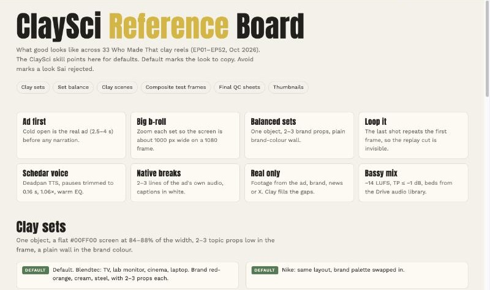
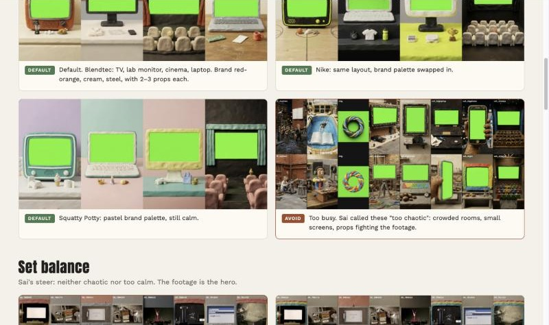
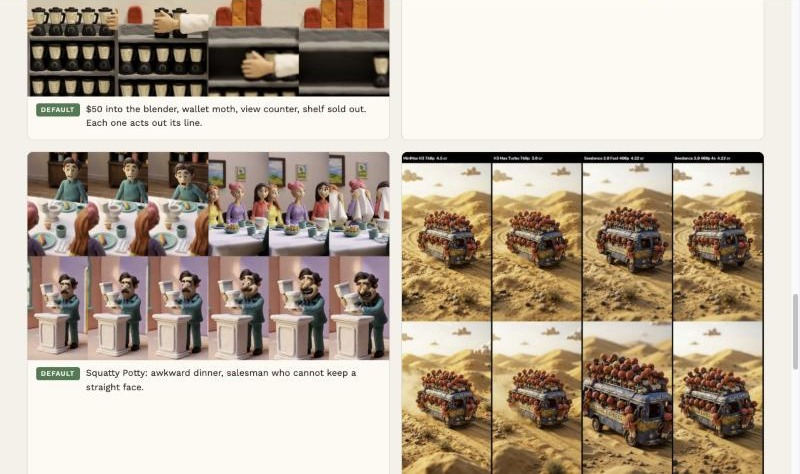
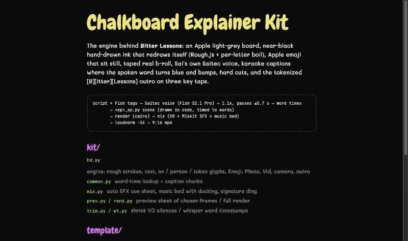
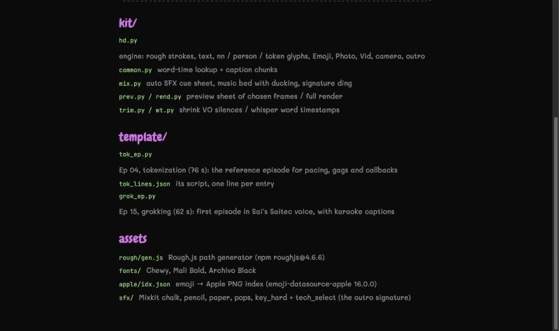
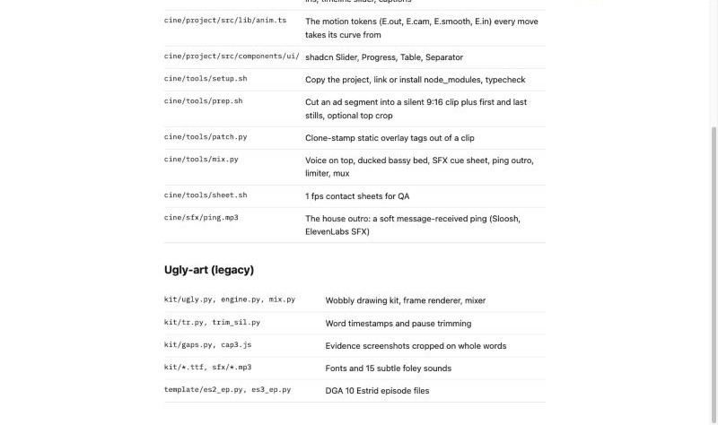

<div align="center">

# 🎬 Reel Kits

### *three kits for making short videos: clay, chalk, and cinema.*



`short-form video` · `skill files` · `Remotion` · `claymation` · `explainers` · `nov 2026`

</div>

---

> 🎬 **what this is.**
> three "kits" for making short-form reels with Claude.
> each kit is a reference board, a set of rules, and real files.
> 🧱 **ClaySci**: a board of 33 clay reels, turned into rules.
> 🖍️ **Chalkboard**: a hand-drawn explainer kit, with a code pipeline.
> 🎞️ **Crafeed**: a cinematic ad kit built in Remotion.
> the idea: stop prompting from scratch. build a kit once, reuse it forever.

---

## 📍 inside

```
 1. 🍿  the short version
 2. 🎲  why "just prompt it" fails for video
 3. 🧱  ClaySci: the clay board
 4. 🖍️  Chalkboard: the explainer kit
 5. 🎞️  Crafeed: the cinematic kit
 6. 🧩  what every kit has in common
 7. 🧭  how we reverse-engineered the styles
 8. 🛠️  how to build your own kit
 9. 🚀  possibilities
10. 📚  lessons
```

---

## 🍿 1. the short version

I make a lot of reels. 🎥
And every new one used to start from zero.
New prompt. New look. New guesswork.

The results were all over the place.
One great. Two meh. One weird.

So I stopped prompting from scratch.
I started building **kits**.

A kit is three things:

```
   🧰 A KIT

   📌 a reference board   what "good" looks like, with real examples
   📏 rules               what to always do, what to never do
   📁 files               the code and templates that make it
```

Build it once.
Then every reel in that style starts at 80%.
Not at zero. 🚀
And the series finally looks like a series.

---

## 🎲 2. why "just prompt it" fails for video

```
   😵 PROMPTING FROM SCRATCH

   prompt 1  →  🎬 great!
   prompt 2  →  🎬 different style?
   prompt 3  →  🎬 why is it beige now
   prompt 4  →  🎬 the captions moved
   prompt 5  →  🎬 who added a vignette

   result: 5 reels, 5 looks. no series.
```

A series needs to look like a series.
Same captions. Same pacing. Same colours.
Viewers learn your style. They trust it.

Prompts drift. Kits don't. 📏

And video is expensive.
Every bad generation costs credits and time.
A kit cuts the bad ones before they happen.

---

## 🧱 3. ClaySci: the clay board

**ClaySci** is my claymation science style.
Clay props. Real footage in clay frames. Deadpan voice.

The kit started as a board.
33 clay reels I loved, pulled apart one by one.

### 📏 the rules

Each reel taught a rule.
Eight made the cut:

```
   🧱 CLAYSCI RULES

   1. 📺 Ad first       open with the real ad or product. hook = reality.
   2. 🎞️ Big b-roll     real footage, shown big, inside clay screens.
   3. ⚖️ Balanced sets   2-3 props. never a cluttered table.
   4. 🔁 Loop it        the last frame flows into the first.
   5. 😐 Deadpan voice  calm, dry, a little funny. never hyped.
   6. ✂️ Native breaks   cut where the platform expects it.
   7. ✅ Real only       real products, real footage. no fake b-roll.
   8. 🔊 Bassy mix      warm, soft, about -14 LUFS. never shrill.
```

**📺 Ad first** is the big one.
Most clay reels open on a cute set.
Ours opens on the real thing.
The real ad. The real product.
Then the clay explains it. 🧠

**🔊 Bassy mix** has a number: -14 LUFS.
That's roughly where Instagram and YouTube normalise audio.
Mix to that and your reel doesn't get squashed. 🎚️

### ✅ default vs ❌ avoid



The board shows pairs.
What to do. What to avoid.
Side by side, so the difference is obvious.

```
   ✅ DEFAULT                     ❌ AVOID
   ──────────────────             ──────────────────
   colours from the brand         random rainbow clay
   2-3 relevant props             a table full of stuff
   real footage in a clay frame   AI footage pretending to be real
   smooth motion                  jittery fake stop-motion
   one idea per scene             three ideas fighting
```

That last-but-one surprised me.
I assumed claymation *needs* jitter.
It doesn't. The board showed smooth reads better.
The clay texture already says "handmade". ✋

### 🧪 the model bake-off



The board ends with a bake-off.
Same scene. Several video models.
Side by side. 🏁

```
   🏁 BAKE-OFF (same prompt, same frame)

   model A   ⭐⭐⭐⭐   best texture, slower
   model B   ⭐⭐⭐     fast, softer detail
   model C   ⭐⭐       clay melts on motion
```

You pick a default model *once*.
With evidence. Not vibes.
Then the kit just uses it. 🧱

---

## 🖍️ 4. Chalkboard: the explainer kit



**Chalkboard** is for "how does it work" explainers.
A dark board. Chalky lines that draw themselves.
Apple emoji as icons. My cloned voice reading.
Karaoke captions underneath. 🎤

It was built for a series called *Bitter Lessons*.
Short lessons about AI and tech.

### 🔧 how it works

```
   🖍️ THE CHALKBOARD PIPELINE

   ✍️ script
     ↓
   🗣️ voice        (my cloned voice, Saitec)
     ↓
   ⏱️ word timings  (when each word is said)
     ↓
   🎨 board         (shapes redrawn with a rough, sketchy line)
     ↓
   🎤 captions      (karaoke: the spoken word lights up)
     ↓
   🎚️ mix           (voice + soft music + tiny SFX)
     ↓
   🎬 render
```

**🎨 The rough line.**
Shapes are drawn with Rough.js.
It turns clean vectors into hand-drawn ones.
Every redraw wobbles a little differently.
Like chalk. Never stamped. ✏️

**🎤 The karaoke captions.**
Word timings come from the voice track.
So each word lights up as it's spoken.
Your eye follows the voice. 👀

### 📁 the files



The kit is real code. A small toolbox:

```
   📁 CHALKBOARD KIT

   hd.py          render in full HD
   common.py      shared helpers: colours, fonts, timing
   mix.py         audio mix: voice on top, music under
   prev.py        quick low-res previews
   rend.py        the final render
   trim.py        trim silences and retakes
   wt.py          word timings for captions
   templates/     board layouts
   assets/        emoji, textures, sounds
```

**prev.py** is the unsung hero. 🦸
Fast previews mean you see problems early.
Before burning a full render.
Look, fix, look again. In minutes.

---

## 🎞️ 5. Crafeed: the cinematic kit



**Crafeed** makes ads and ad teardowns.
So it needed a different feel. Cinematic.
Big type. Hard cuts. Real product footage.

The kit is built in **Remotion**.
Remotion makes videos with React code.
Each scene is a component.
Each animation is a number you can tweak. ⚛️

```
   🎞️ CRAFEED KIT v6

   ┌──────────────────────────────────────┐
   │ 🎬 scenes       hook, problem, proof, │
   │                 product, close        │
   │ 🔤 type         big, bold, one line   │
   │ ✂️ cuts         hard cuts, snap zooms │
   │ 🎨 grade        subtle cinematic,     │
   │                 no vignette           │
   │ 🔊 audio        music + SFX library   │
   └──────────────────────────────────────┘
```

v6 means it took six rounds. 😅
Each version fixed what the last got wrong.

The kit also keeps the **legacy** one.
An older, scrappier "ugly-art" style.
Lo-fi on purpose. Sometimes that wins.
So it stays in the box, labelled clearly.

```
   v1 → v2 → v3 → v4 → v5 → v6 ✅
   │                         │
   └── legacy "ugly-art" ────┘ (kept, labelled)
```

Never delete an old kit.
Some briefs want exactly that look. 🗃️

---

## 🗓️ 5½. a day with a kit

What does using a kit actually look like?
Say I want a ClaySci reel about a new phone. 📱

```
   🗓️ ONE REEL, WITH A KIT

   09:00  ✍️ write the script (60-80 s, one idea)
   09:20  📺 grab the real ad + product footage
   09:40  🧱 load ClaySci → rules + props + default model
   10:00  🎨 stills first: one keyframe per scene
   10:30  👀 check stills against the do/avoid board
   11:00  🎬 animate only the stills that passed
   12:00  🎚️ mix to -14 LUFS, voice on top
   12:20  👀 preview, fix two things
   12:40  ✅ final render + thumbnail
```

Without the kit, that morning is a week.
Every decision gets re-made.
Which model? Which colours? How loud?
With the kit, those are already answered. ⏱️

**Stills first** is the big money saver.
A still costs a fraction of a video.
Check every scene as a still.
Only animate the ones that pass. 💸

**The do/avoid board** is the checklist.
Hold each still next to it.
Too many props? Redo.
Rainbow clay? Redo.
Takes seconds. Saves renders.

### 🙅 when NOT to use a kit

Kits aren't always right.

```
   🙅 SKIP THE KIT WHEN…

   🧪 you're exploring a brand-new style
   🎯 the brief wants something nobody's seen
   🔥 a trend moves faster than a kit can update
```

Kits are for *series*.
For one-off experiments, play freely.
If an experiment works three times,
then it earns a kit. 🧰

---

## 🧩 6. what every kit has in common

Three different styles.
Same skeleton underneath.

```
   🧩 THE KIT SKELETON

   📌 BOARD      real examples of "good", pulled apart
   📏 RULES      8-ish rules, each with a reason
   ✅❌ PAIRS     do vs avoid, side by side
   🏁 BAKE-OFF   models or settings tested, winner picked
   📁 FILES      code, templates, assets
   👀 PREVIEW    a fast way to check before the full render
   🔊 MIX        a loudness target and a voice-first rule
```

If a kit is missing one of these, it wobbles.
No board? Rules drift.
No pairs? People misread the rules.
No preview? You waste renders. 💸

---

## 🧭 7. how we reverse-engineered the styles

Each kit came from studying reels I loved.
Not copying them. Pulling them apart.

```
   🔬 THE TEARDOWN LOOP

   1. 🎞️ collect 20-40 reels in one style
   2. ⏸️ pause every few seconds, screenshot
   3. 📝 note: hook, cuts, captions, colours, sound
   4. 🔁 find what repeats across most of them
   5. 📏 turn each repeat into a rule
   6. 🧪 make one reel with the rules
   7. 🔍 compare side by side, fix the rules
```

Step 4 is the trick.
One reel can be a fluke.
A pattern across 30 reels is a rule. 📏

And step 7 never really ends.
Every new reel tests the rules.
When one breaks, the kit gets updated.
That's why Crafeed is on v6.

Credit where it's due:
the styles are inspired by creators I watch.
The kits contain no copied footage, art or audio.
Just the lessons, written as rules.

---

## 🛠️ 8. how to build your own kit

### 📋 the steps

1. **Pick one style.** Not three. One.
2. **Collect 20+ examples.** Save links and screenshots.
3. **Pull them apart.** Hook, cuts, captions, colours, sound.
4. **Write ~8 rules.** Each with a one-line reason.
5. **Make do/avoid pairs.** Visual, side by side.
6. **Run a bake-off.** Test models or settings on one scene.
7. **Write the files.** Templates, helpers, a preview script.
8. **Set a loudness target.** -14 LUFS is a good start.
9. **Make one reel. Fix the kit.** Repeat.

### 🤖 a starter prompt

```
Help me build a reusable video kit for [style]. I'll give you 20+
example reels. For each, note the hook, cut rhythm, caption style,
colour palette and sound. Find what repeats across most of them and
turn it into about 8 rules, each with a one-line reason. Make a board
with do/avoid pairs. Then set up a small code toolbox: a quick
preview render, a full render, a word-timing script for captions,
and an audio mix that keeps voice on top at about -14 LUFS.
```

---

## 🚀 9. possibilities

```
   🚀 WHERE KITS GO NEXT

   🧰 kit marketplace     share kits like templates
   🤖 auto-critique       a script scores each reel against the rules
   🎨 brand kits          one kit per brand: colours, voice, props
   🔀 kit mixing          clay props on a chalkboard? why not
   📊 kit analytics       which rules actually lift watch time
   🧑‍🏫 kits as skills      load a kit, and Claude just knows the style
```

**🤖 Auto-critique** is the next build.
Render a reel. Run the checker.
"Captions overlap at 0:12. Vignette detected. Mix too loud."
Fix before anyone sees it. ✅

**🧑‍🏫 Kits as skills** is already half true.
Each kit lives as a skill file.
Say "make a ClaySci reel" and the rules load.
The kit becomes a teammate. 🤝

---

## 📚 10. lessons

**1. Stop prompting from zero.** 🧰
Build a kit once. Start every reel at 80%.

**2. Patterns, not flukes.** 📏
One reel is luck. Thirty reels is a rule.

**3. Show do vs avoid.** ✅❌
Pairs teach faster than paragraphs.

**4. Bake off with evidence.** 🏁
Pick models by side-by-side tests, not vibes.

**5. Preview fast.** 👀
Cheap previews save expensive renders.

**6. Mix for the platform.** 🔊
About -14 LUFS. Voice on top. Never shrill.

**7. Real beats fake.** ✅
Real footage inside a style beats generated filler.

**8. Keep old kits.** 🗃️
Today's legacy look is tomorrow's brief.

**9. Stills before video.** 🖼️
Check every scene as a still. Animate only what passes.

**10. Kits are for series.** 🔁
Experiment freely. Kit it once it works three times.

---

<div align="center">

```
    🧱 ClaySci       🖍️ Chalkboard       🎞️ Crafeed
    clay + real      chalk + voice       cinema + cuts
        └──────────────┬──────────────────┘
                build once. reuse forever. 🧰
```

*part of [reverse-engineered](../README.md) by [sai](https://5aitec.com) · made with Claude*

</div>
