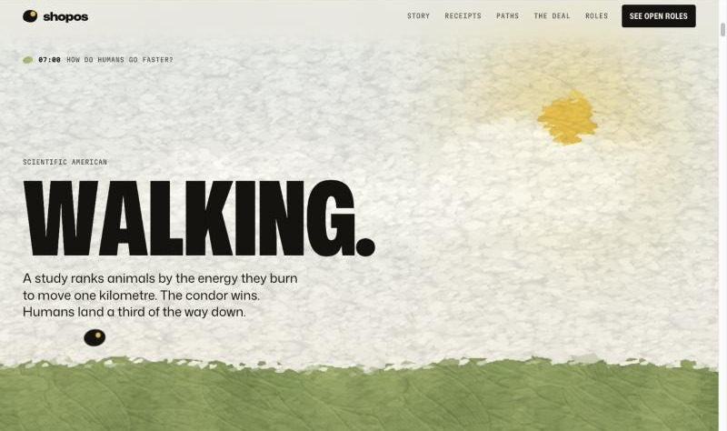
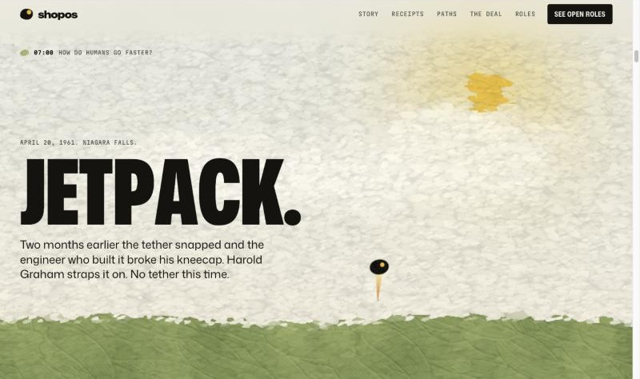
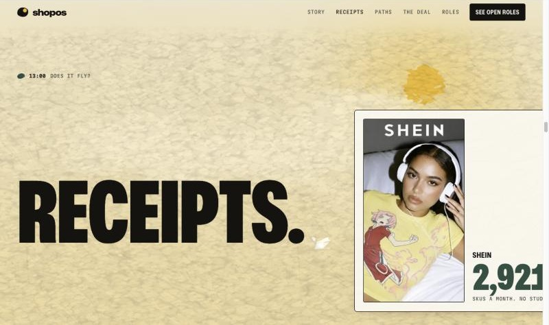
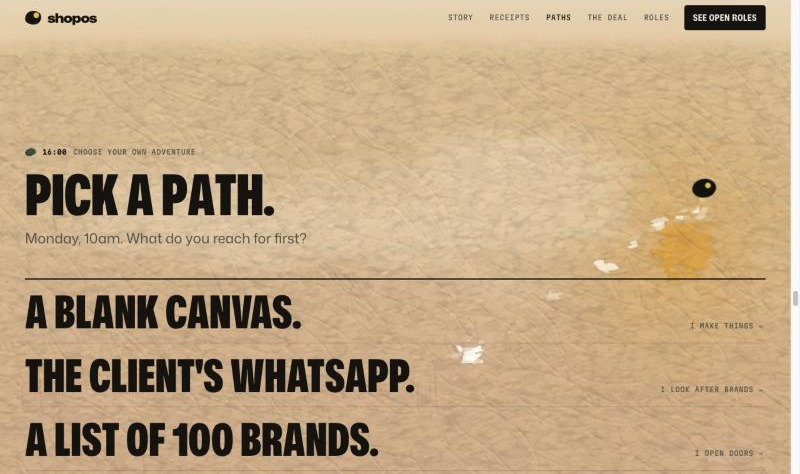
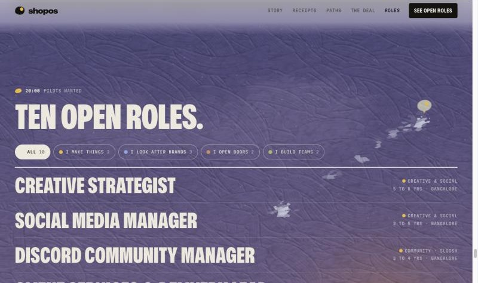

<div align="center">

# 🚀 ShopOS Careers: Jetpacks for Creativity

### *a careers page as one painted day. a little pilot flies you to ten open roles.*



`reverse-engineered` · `careers page` · `webgl sky` · `storytelling` · `nov 2026`

</div>

---

> 🧑‍🚀 **what this is.**
> a careers page concept for [ShopOS](https://shopos.ai).
> it borrows the "one painted day" idea from our [Ardia study](../ardia-field-notes),
> then tells a story: how humans went faster, from walking to bicycles to a 1961 rocket belt,
> and why AI is the next jetpack for creative people.
> it ends at ten open roles. this README shows how the story and the page were built.

---

## 📍 inside

```
 1. 🍿  the short version
 2. 😴  why most careers pages are boring
 3. 🌅  the borrowed idea: a page that is a day
 4. 🚶  07:00 · walking
 5. 🚀  the jetpack, 1961
 6. 🧾  13:00 · receipts
 7. 🛤️  16:00 · pick a path
 8. 🌙  20:00 · ten open roles
 9. 🧑‍✈️ the little pilot
10. 🛠️  how to build a story-driven careers page
11. 🚀  possibilities
12. 📚  lessons
```

---

## 🍿 1. the short version

Most careers pages say the same thing.
"We're a fast-growing team. We value ownership. Ping-pong table." 🏓

We wanted ours to *argue something*.
The argument:

> **Humans have always used tools to go faster.**
> **AI is the jetpack for creative people.**
> **Come fly it with us.**

So the page tells that story,
from sunrise to night,
and lands you on the open roles at the end.

---

## 😴 2. why most careers pages are boring

```
   THE AVERAGE CAREERS PAGE 😴

   🏢 "about us"           (copied from the homepage)
   💎 "our values"         (ownership, curiosity, bias for action)
   📸 a team photo         (someone is blinking)
   🎁 "perks"              (snacks!)
   📋 [ list of jobs ]
```

None of that answers the real question a great candidate has:
**"Why would I spend years of my life at this place?"**

Great people don't join perks.
They can get snacks anywhere. 🍪
They join a *bet*.
A belief about the future they want to be early to.
So the page should make the bet. Out loud. 🎲

---

## 🌅 3. the borrowed idea: a page that is a day

We studied [ardia.dev](https://ardia.dev) closely (see [Ardia Field Notes](../ardia-field-notes)).
Its big idea: **scroll the page, the day passes.**

We borrowed the *idea*, credited it,
and used it for a completely different story.

```
   THE CAREERS DAY 🌍

   07:00  🌅 how do humans go faster?    (walking)
   ...    🚲 the bicycle
   ...    🚀 the jetpack, 1961
   13:00  ☀️ does it fly?                 (receipts: proof AI works)
   16:00  🌇 choose your own adventure   (pick a path)
   20:00  🌙 pilots wanted               (ten open roles)
```

Each section has a clock time in the corner.
`07:00 · HOW DO HUMANS GO FASTER?`
`13:00 · DOES IT FLY?`
`20:00 · PILOTS WANTED`

The sky behind it changes with the time.
A live WebGL sky, painted.
Sunrise at the top. Moonrise at the bottom. 🌙

The clock does two jobs:
it tells you where you are in the story,
and it makes the page feel like *a day you spent with us*.

---

## 🚶 4. 07:00 · walking


> **WALKING.**
> *A study ranks animals by the energy they burn to move one kilometre.*
> *The condor wins. Humans land a third of the way down.*

We open with a true, slightly humbling fact.
On our own, humans aren't very efficient movers.
Condors glide. We plod. 🦅🚶

Then comes the twist the story is built on.
A human *on a bicycle* beats every animal on that list.
That's the famous idea behind "a bicycle for the mind".
Tools don't just help us.
They make us the best at things we were bad at.

```
   THE ENERGY LADDER 🪜

   🦅 condor            most efficient on its own
   ...
   🚶 human, walking     a third of the way down 😅
   ...
   🚲 human + bicycle    beats them all 🏆
```

That's the whole thesis, in one chart.
Humans + the right tool = unbeatable.
The rest of the page is just: "the right tool now is AI."

---

## 🚀 5. the jetpack, 1961



> **JETPACK.**
> *April 20, 1961. Niagara Falls.*
> *Two months earlier the tether snapped and the engineer who built it broke his kneecap.*
> *Harold Graham straps it on. No tether this time.*

This is the emotional core.
A real story from the first rocket-belt flights.
Someone got hurt testing it.
Someone else strapped in anyway.
And flew. 🚀

The little pilot character (more on them below)
takes off at this exact moment, with a tiny flame.

Why tell this story on a careers page?
Because it's exactly what joining an AI-native company feels like.
The tools are new. Sometimes the tether snaps.
You need people who strap in anyway.
Carefully. But they strap in. 🪖

---

## 🧾 6. 13:00 · receipts



> **RECEIPTS.**
> *13:00 · does it fly?*

Big claims need proof.
So at midday the page shows receipts:
real-world examples of how fast creative production now moves.

The first receipt is a public one:
a giant fast-fashion retailer shipping thousands of new products a month,
with a scale no traditional studio setup could match.
(That number is from public reporting, not from us.)

```
   WHY RECEIPTS MATTER 🧾

   claim without proof   → "sure, buddy" 🙄
   claim with receipt    → "okay, show me more" 👀
```

Then come our own receipts:
what our teams and tools actually shipped.
Each one with its number.
Catalogue images made in a day, not a month.
Ad variants tested in a week, not a quarter.
The point isn't the exact numbers.
It's that the speed is *real*, and you'd be part of it. ⚡

The rule we followed:
**every claim on the page gets a receipt.**
If we couldn't prove it, we cut it. ✂️

---

## 🛤️ 7. 16:00 · pick a path



> **PICK A PATH.**
> *Monday, 10am. What do you reach for first?*

This is the choose-your-own-adventure part. 🎮

```
   MONDAY, 10AM. YOU REACH FOR... 🤔

   🎨 A BLANK CANVAS.            → i make things
   💬 THE CLIENT'S WHATSAPP.     → i look after brands
   📋 A LIST OF 100 BRANDS.      → i open doors
   👥 (and one more)             → i build teams
```

Instead of asking "what's your job title?",
it asks "what do you *reach for* on a Monday?"
That's a much better question.
It sorts people by instinct, not by CV.
And it's fun to answer. Honestly.

Each path plays out like a mini story.
Some end with a crash. 💥
Some end with liftoff. 🚀
(Honest about the bad days too. That builds trust.)

And each path filters the roles at the end.

---

## 🌙 8. 20:00 · ten open roles



> **TEN OPEN ROLES.**
> *20:00 · pilots wanted.*

Night falls. The sky goes deep purple.
The roles appear.

Filter chips match the paths:
`ALL 10` · `I MAKE THINGS 3` · `I LOOK AFTER BRANDS 3` · `I OPEN DOORS 2` · `I BUILD TEAMS 2`

Each role shows its team, experience range and city.
Big, bold, scannable.
Creative strategist. Social media manager. Community manager. And more.

Ending at night feels right.
You've spent a whole day with us.
Now it's quiet. Time to decide. 🌙
The apply button doesn't shout.
By now, it doesn't need to.
If the story landed, you're already in.

---

## 🧑‍✈️ 9. the little pilot

There's a tiny round character on every screen.
A little black blob with a yellow eye. 🟡⚫
It walks in the morning.
It takes off at the jetpack.
It flies alongside you, all the way to the roles.

```
   THE PILOT'S DAY 🧑‍✈️

   07:00   🚶 walking on the grass
   1961    🚀 strapped in. tiny flame.
   13:00   ✈️ flying past the receipts
   16:00   🌀 circling the paths
   20:00   🌙 waiting by the roles
```

Why a character?
Because a scroll story needs a *guide*.
Your eye follows the pilot.
The pilot follows the story.
It's the oldest trick in animation. A friend who walks with you. 🫶

## 📐 the craft: type, paint, motion

Under the story, there's a tight visual system.

```
   THE CAREERS PAGE KIT 🧰

   🔠 HEADLINES      huge condensed caps. one word if possible.
                     WALKING. JETPACK. RECEIPTS.
   🕐 CLOCK LABELS   tiny mono caps with a paint dab: "07:00 · how do humans go faster?"
   📄 PAPER          a soft paper grain over everything
   🌿 GROUND         a torn, painted grass edge at the bottom of early sections
   🌤️ SKY            a WebGL sky, brushed, moving from cream to gold to purple
   ☀️ SUN            a painted dab that drifts across the day
   🟡⚫ PILOT         one tiny character, the only "cute" thing on the page
```

**One-word headlines.** 🔠
WALKING. JETPACK. RECEIPTS.
Each section gets a single word you could read from across a room.
Then two or three short lines underneath.
That's it. No paragraphs fighting the art.

**Clock labels.** 🕐
Small monospace caps, with a tiny paint dab as a bullet.
They feel like a logbook. A pilot's log, really. 📒
That matches the jetpack story perfectly.

**Paint, not gradients.** 🎨
The sky isn't a CSS gradient.
It's brushed. You can see strokes.
The sun is a dab of yellow paint, not a perfect circle.
That roughness makes it feel handmade. Human.
Which matters on a page arguing that *humans* fly the tools.

**Motion is slow.** 🐢
The sky drifts. The pilot bobs. The sun creeps.
Nothing snaps or bounces.
A day passes slowly. So does the page.

The whole kit is small on purpose.
A handful of rules, used everywhere.
That's what makes a long scroll feel like *one* thing. 🧩

---

## 🛠️ 10. how to build a story-driven careers page

### 📋 the recipe

1. **Write the bet in one line.** What do you believe that others don't?
2. **Find a true story that proves it.** History is full of them.
3. **Give the page a spine.** A day, a journey, a season.
4. **Add receipts.** Every claim gets proof, or gets cut.
5. **Sort people by instinct.** "What do you reach for?" beats "what's your title?"
6. **Add a guide character.** Something the eye can follow.
7. **End at the roles.** Filtered by the path they chose.

### 🤖 a starter prompt

```
Build a careers page for [company] that argues one bet: [your bet].
Structure it as one day, with a clock time on each section, and a
painted sky behind it that moves from sunrise to night as you scroll.
Open with a true historical story that proves the bet. Add a
"receipts" section where every claim has proof. Add a choose-your-own
-adventure "Monday 10am, what do you reach for?" with 4 paths. End
with open roles filtered by path. Add a small guide character that
travels with the reader. Credit any design reference you borrow.
```

### ⚖️ credit where it's due

The "page as a day" idea and the painted sky came from studying ardia.dev.
We credit it. We changed the story, the content and the art direction.
Borrow ideas openly. Say where they came from. 🙏

---

## 🚀 11. possibilities

```
   STORY-DRIVEN PAGES, BEYOND CAREERS 📖

   🏢 an "about us" page         the company's day, from first commit to now
   💰 an investor page           the bet, the receipts, the path
   🎓 an internship page         "your first day with us", hour by hour
   🤝 a partner page             "pick a path": studio, agency, freelancer
   🛍️ a product launch           the product's day, from making to unboxing
```

And for the careers page itself:
- 🎙️ **Voice notes from the team** at each hour of the day.
- 🎮 **A real mini-task** at the end of each path, instead of a CV upload.
- 📊 **Live receipts** pulled from what the team shipped this week.

---

## 📚 12. lessons

**1. Make a bet, not a brochure.** 🎲
Great people join a belief.

**2. True stories beat value statements.** 📜
"Harold Graham straps it on" lands harder than "we value courage".

**3. Every claim needs a receipt.** 🧾
Or it goes.

**4. Ask what people reach for.** 🤲
Instinct sorts better than titles.

**5. A guide character keeps eyes moving.** 🧑‍✈️
People follow a friend through a long scroll.

**6. Be honest about crashes.** 💥
Showing the bad days builds more trust than hiding them.

**7. Borrow ideas, credit loudly.** 🙏
We took "a page is a day" from ardia.dev and said so.

**8. Small kits make long pages feel whole.** 🧩
One-word headlines, clock labels, paint, a pilot. Used everywhere.

---

<div align="center">

```
   07:00 🚶  ──►  1961 🚀  ──►  13:00 🧾  ──►  16:00 🛤️  ──►  20:00 🌙
                    jetpacks for creativity. pilots wanted.
```

*part of [reverse-engineered](../README.md) by [sai](https://5aitec.com) · made with Claude*

</div>
