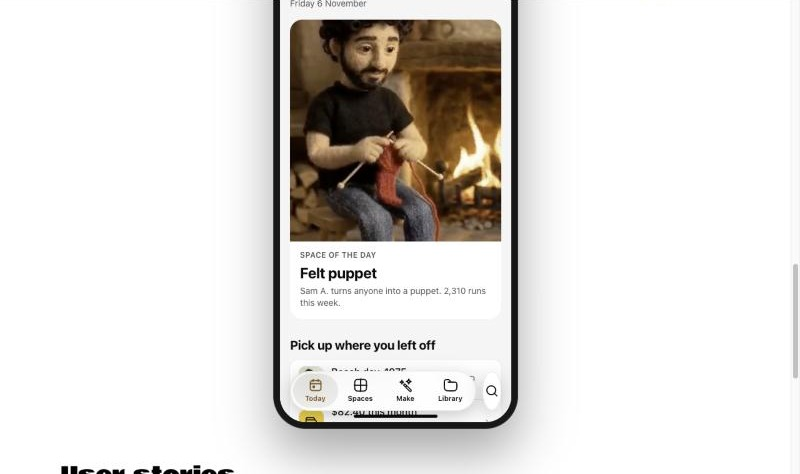
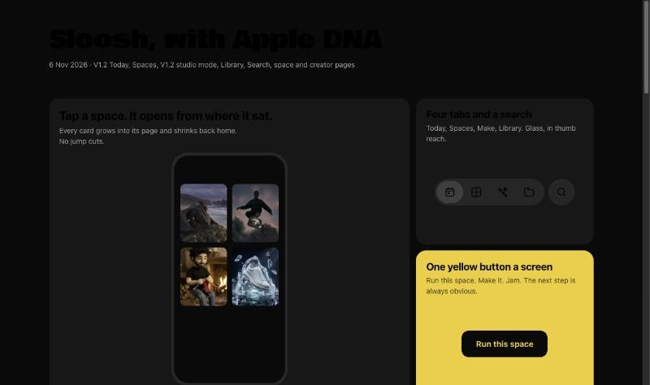
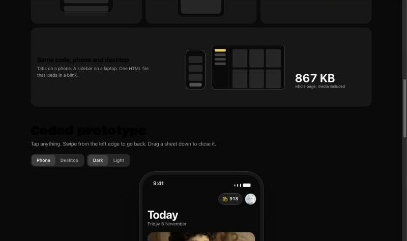
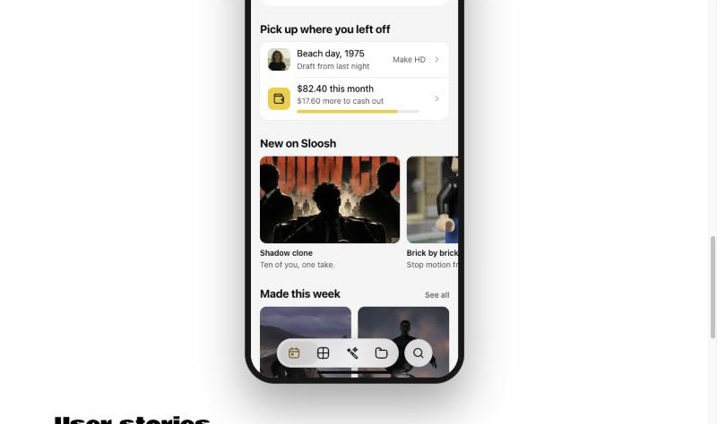
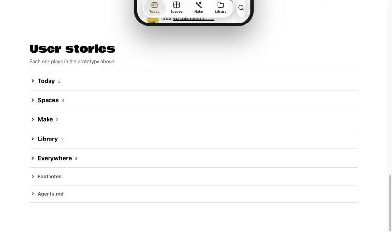

<div align="center">

# 🍎 Sloosh, with Apple DNA

### *what if a generative media app felt like it shipped from cupertino?*



`reverse-engineered` · `design language` · `mobile prototype` · `user stories` · `nov 2026`

</div>

---

> 🐤 **what this is.**
> [Sloosh](https://sloosh.ai) is the generative media platform we build at ShopOS.
> images, video, voice, music. "Spaces" are one-tap creative recipes anyone can run.
> this was a design study: take Apple's interface habits and rebuild Sloosh with them.
> large titles. a glass tab bar. zoom opens. swipe-back. sheets. a Photos-style library.
> all in one light HTML page: a bento of ideas, a coded prototype, and the user stories.

---

## 📍 inside

```
 1. 🍿  the short version
 2. 🧬  what "apple DNA" actually means
 3. 🧭  how we reverse-engineered it
 4. 🎛️  the bento: six ideas on one screen
 5. 📱  the coded prototype
 6. ☀️  the today tab
 7. 🗂️  four tabs and a search
 8. 🟨  one yellow button a screen
 9. 📜  user stories, playable
10. 🛠️  build your own "X with Apple DNA"
11. 🚀  possibilities
12. 📚  lessons
```

---

## 🍿 1. the short version

Creative AI apps are *loud*.
Neon gradients. Ten sliders. Model dropdowns. Credit counters everywhere.
They feel like cockpits. ✈️

Apple apps feel like the opposite.
Calm. Obvious. One thing at a time.
You never wonder what to tap next.

So the question was:
**what does Sloosh look like if Apple designed it?**

We studied Apple's own apps.
Pulled out the habits.
Rebuilt Sloosh's main screens with those habits.
Then wrote user stories you can play inside the prototype.

---

## 🧬 2. what "apple DNA" actually means

"Make it like Apple" is the vaguest brief in design. 😅
So we broke it into concrete moves.

```
   APPLE DNA, DECODED 🧬

   🔠 large titles       big bold screen title that shrinks as you scroll
   🫧 glass tab bar      frosted bar at the bottom, always in thumb reach
   🔍 zoom opens         tap a card, it grows into its page. tap back, it shrinks home.
   👈 swipe-back          drag from the left edge to go back. always.
   📄 sheets             tasks slide up from the bottom. drag down to dismiss.
   🖼️ photos-style grid  your library looks like the Photos app
   🎯 one primary action one obvious button per screen
```

Each of these is a *habit* people already have.
Every iPhone user knows swipe-back.
Every iPhone user knows sheets.
So Sloosh needs zero teaching.
You already know how to use it. 🧠

That's the real value of borrowing a platform's DNA.
Not the looks.
The *muscle memory*.

---

## 🧭 3. how we reverse-engineered it

```
   STUDYING APPLE'S HABITS 🔍

   📱 1. open Apple's own apps     Photos, App Store, Music, Notes
        │
        ▼
   🎞️ 2. screen-record transitions  how does a card open? how does back feel?
        │
        ▼
   📏 3. measure                    title sizes, tab bar height, corner radii, timing
        │
        ▼
   🧾 4. name the habits            the seven moves in the table above
        │
        ▼
   🐤 5. map to Sloosh              which Sloosh screen needs which habit?
        │
        ▼
   🧪 6. prototype + stories        build it. then write stories you can play.
```

The App Store "Today" tab was the big reference.
A daily editorial card on top.
Then rows of things to explore.
It turns a store into a *magazine*.

That's exactly what Sloosh needs.
A daily reason to open the app.
Something new, every day, picked by a human. 📰

---

## 🎛️ 4. the bento: six ideas on one screen



The page opens with a bento.
Each tile is one idea, shown not told.

**📱 Tap a space. It opens from where it sat.**
Every card grows into its page and shrinks back home.
No jump cuts.

**🗂️ Four tabs and a search.**
Today, Spaces, Make, Library.
Glass, in thumb reach.

**🟨 One yellow button a screen.**
Run this space. Make it. Jam.
The next step is always obvious.



**💻 Same code, phone and desktop.**
Tabs on a phone. A sidebar on a laptop.
One HTML file that loads in a blink.
**867 KB.** Whole page, media included.

That last number matters. ⚡
Creative apps get *heavy*.
Showing the whole prototype weighs under a megabyte
is a quiet flex. And a promise: this can be fast.

---

## 📱 5. the coded prototype

> **Tap anything. Swipe from the left edge to go back. Drag a sheet down to close it.**

The middle of the page is a real, working phone prototype.
Not a picture. Not a video.
You can tap through it.

Toggles at the top:
- 📱 Phone / 💻 Desktop
- 🌙 Dark / ☀️ Light

So you can see every screen in every mode.
That's how you catch problems early.
A screen that looks great in dark mode
often breaks in light mode. And vice versa. 🌗

---

## ☀️ 6. the today tab


> **Today · Friday 6 November**

The first tab is a daily magazine.

**🧸 Space of the Day: Felt puppet.**
"Turns anyone into a puppet. 2,310 runs this week."
A big, warm image of a felted puppet knitting by a fire.
One tap to try it.

Why a "space of the day"?
Because blank prompts are scary. 😰
Most people don't know what to make.
A daily pick says: "try *this*. Today."
It removes the hardest step: deciding.



Below that:

**↩️ Pick up where you left off.**
"Beach day, 1975 · draft from last night · Make HD."
Your unfinished work, one tap away.

**💰 Creator earnings.**
A little card showing what you've earned from your published spaces this month,
and how far you are from cashing out.
A progress bar. Like a game. 🎮
(Demo numbers, not real ones.)

**🆕 New on Sloosh.**
"Shadow clone: ten of you, one take."
"Brick by brick: stop motion from a photo."

**📸 Made this week.**
A grid of what you made. Like Photos' "For You".

```
   THE TODAY TAB, TOP TO BOTTOM ☀️

   🧸 space of the day      → removes "what should i make?"
   ↩️ pick up where you left → removes "where was i?"
   💰 your earnings          → gives a reason to publish
   🆕 new on sloosh          → shows what's possible
   📸 made this week         → shows your own progress
```

Every block answers a question a user has when they open the app.
That's how Apple designs Today.
Not "what can we show?"
But "what does the person need right now?" 🎯

### 🌗 a real bug we caught while documenting this

Fun one. 😅
When I captured these screenshots in dark mode,
some big headings went *black on black*.
"Sloosh, with Apple DNA" basically vanished.
"Coded prototype" too.

```
   THE DARK MODE TRAP 🌗

   ☀️ light mode    black heading on white      ✅ readable
   🌙 dark mode     black heading on near-black ❌ invisible
                    (the heading colour was hard-coded, not a token)
```

The cause is classic.
Someone set the heading colour directly, as "black".
Instead of using a colour *token* like "text-primary"
that flips automatically between modes.

The fix is one line per heading.
The lesson is bigger:
**never hard-code a colour. Always use a token.**
Apple's own system colours work exactly this way.
"Label" is black in light mode and white in dark mode.
You never pick black. You pick "label".

That's also why the prototype has the light/dark toggle up top.
So you catch this *before* users do.
We caught it by documenting.
Which is a nice argument for documenting everything. 📸

---

## 🗂️ 7. four tabs and a search

```
   THE TAB BAR 🫧

   ┌──────────────────────────────────────────┐
   │  📅 Today   ⊞ Spaces   ✨ Make   📁 Library │  🔍
   └──────────────────────────────────────────┘
         frosted glass · bottom · thumb reach
```

Four tabs. Not seven. Not twelve.

- **📅 Today:** what's new, picked for you.
- **⊞ Spaces:** browse every creative recipe.
- **✨ Make:** start from scratch.
- **📁 Library:** everything you've made.

Search sits apart, as a round button.
Exactly like Apple's newer apps do.

Why only four?
Every extra tab is a decision.
Every decision is friction.
Four is the number a thumb can remember. 👍
Apple's own apps mostly stop at four or five.
There's a reason. Your thumb is the real designer.

---

## 🟨 8. one yellow button a screen

Sloosh's brand colour is a warm yellow.
We gave it one job:
**the main action, once per screen.**

```
   ONE BUTTON RULE 🟨

   space page   → [ Run this space ]
   make page    → [ Make it ]
   result page  → [ Jam ]  (remix with a human expert)
```

Never two yellow buttons.
Never a yellow decoration.
If it's yellow, it's the next step.

That's a tiny rule that does a lot.
Your eye learns it in one screen.
Then it finds the next step instantly, forever. 👁️

---

## 📜 9. user stories, playable



> **Each one plays in the prototype above.**

The bottom of the page has user stories, grouped by tab:

```
   📅 Today        3 stories
   ⊞ Spaces       4 stories
   ✨ Make         2 stories
   📁 Library      2 stories
   🌍 Everywhere   3 stories
   📝 Footnotes
   🤖 Agents.md
```

Each story is written plainly.
"As a creator, I open Today and see one space worth trying."
And each one has a **"Show me"** link
that drives the prototype to that exact moment. ▶️

That's the part I love most.
Stories aren't a separate document anymore.
They *play*.
Product, design and engineering all look at the same thing.

And there's an **Agents.md** at the end.
A copy-paste brief for a coding agent to build it for real.
Design → stories → agent instructions. One page. 🤖

---

## 🛠️ 10. build your own "X with Apple DNA"

This recipe works for any app.

### 📋 the steps

1. **List the habits.** Large titles, glass tabs, zoom opens, swipe-back, sheets, one primary action.
2. **Pick your Today.** What does a user need the moment they open the app?
3. **Cut to four tabs.** Be brutal.
4. **Give your brand colour one job.** The next step. Nothing else.
5. **Prototype in one HTML file.** Phone and desktop. Light and dark.
6. **Write playable stories.** Each with a "show me".
7. **End with an Agents.md.** So it can actually get built.

### 🤖 a starter prompt

```
Redesign [my app] with Apple's interface habits: large titles that
shrink on scroll, a frosted glass tab bar with at most four tabs plus
search, cards that zoom open from where they sat, swipe-back from the
left edge, bottom sheets you drag down to close, and one primary button
per screen in [brand colour]. Build a single-file HTML prototype with
phone/desktop and light/dark toggles. Add user stories grouped by tab,
each with a "show me" link that drives the prototype. End with an
Agents.md brief for a coding agent.
```

### ⚖️ a note on borrowing

We borrowed *habits*, not *assets*.
No Apple icons. No SF Pro font files. No Apple logos.
Interaction patterns are shared language.
Brand assets are not. 🙏

---

## 🚀 11. possibilities

```
   "WITH APPLE DNA" FOR OTHER PRODUCTS 🍎

   🛍️ a D2C store app        Today = "drop of the day"
   🏋️ a gym app              Today = "workout of the day"
   📰 a news app             Today = "the one story to read"
   🧑‍🍳 a recipe app          Today = "tonight's dinner"
   🏦 a banking app          Today = "what changed since yesterday"
```

And for Sloosh itself:
- 🎙️ **Voice search.** "Make me a puppet video." Opens the right space.
- 📲 **Widgets.** Space of the day on your home screen.
- ⌚ **Watch.** "Your video is ready." Tap to view on phone.
- 👓 **Glasses.** See a scene, say "make it clay". Done.

---

## 📚 12. lessons

**1. Borrow habits, not looks.** 🧠
Muscle memory is the real gift of a platform.

**2. Give people a Today.** ☀️
A blank canvas scares. A daily pick invites.

**3. Four tabs is plenty.** 4️⃣
Every extra tab is a decision you're forcing.

**4. One colour, one job.** 🟨
Make your brand colour mean "next step".

**5. Weight is a feature.** ⚡
867 KB for the whole thing says "fast" before anyone taps.

**6. Stories should play.** ▶️
Specs that drive the prototype end arguments fast.

**7. End with instructions for agents.** 🤖
Design that can't be built is just a picture.

**8. Tokens, never raw colours.** 🎨
One hard-coded black made a whole heading vanish in dark mode.
Use names like "text-primary". Let the system flip them.

**9. Documenting is testing.** 📸
We found a real bug just by screenshotting every state.
Write it up, and you'll see it fresh.

---

<div align="center">

```
   📅 Today  ⊞ Spaces  ✨ Make  📁 Library   🔍
   ─────────────────────────────────────────
         calm. obvious. one yellow button. 🟨
```

*part of [reverse-engineered](../README.md) by [sai](https://5aitec.com) · made with Claude*

</div>
