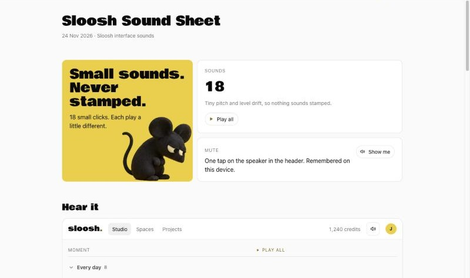
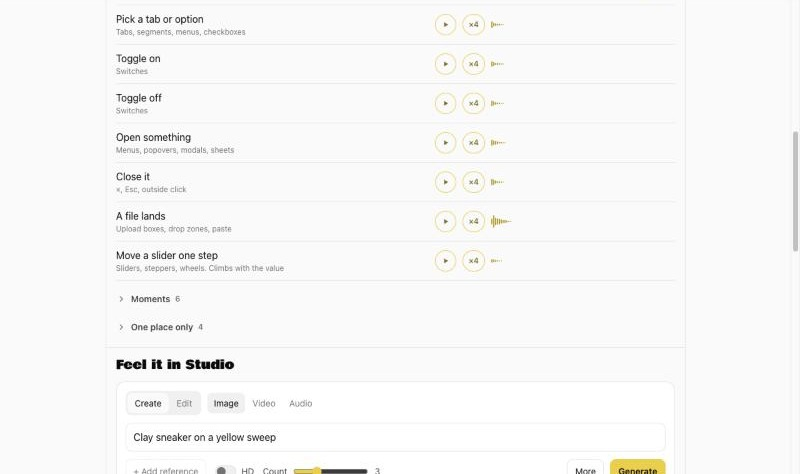
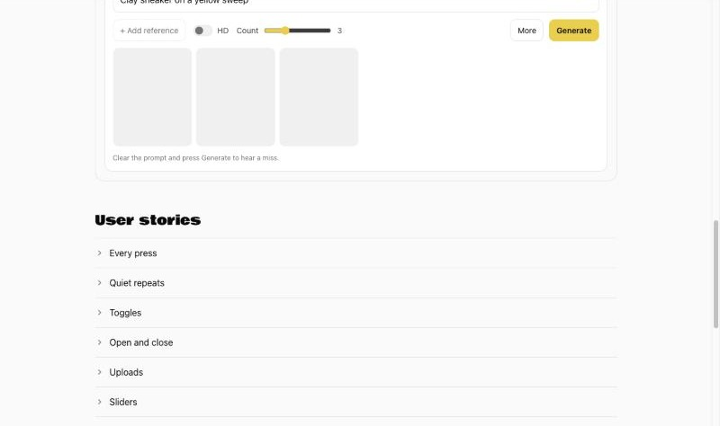

<div align="center">

# 🔊 Sloosh Sound Sheet

### *small sounds. never stamped. 18 little clicks, each play a little different.*



`sound design` · `ui sounds` · `web audio` · `design system` · `nov 2026`

</div>

---

> 🎧 **what this is.**
> a sound system for [Sloosh](https://sloosh.ai)'s interface.
> 18 tiny synthesized sounds: taps, toggles, opens, closes, uploads, sliders, moments.
> each one drifts slightly in pitch and level every time it plays, so nothing sounds robotic.
> plus a mute switch in the header, a live studio playground to feel them in context,
> and user stories for every sound. no audio files. all generated in code.

---

## 📍 inside

```
 1. 🍿  the short version
 2. 🤫  why UI sounds usually fail
 3. 🎲  "never stamped": the drift trick
 4. 🗂️  the 18 sounds
 5. 🔇  the mute switch
 6. 🎨  feel it in studio
 7. 📜  user stories
 8. 🧭  what we reverse-engineered
 9. 🛠️  how to make your own sound sheet
10. 🚀  possibilities
11. 📚  lessons
```

---

## 🍿 1. the short version

Good apps don't just look good.
They *feel* good.
And a lot of "feel" is sound. 🔊

The soft tick when you pick a tab.
The tiny pop when a file lands.
The gentle "whoosh" when a menu opens.

Most web apps are silent.
Some are noisy and annoying.
We wanted Sloosh to be in the middle:
**small sounds, never stamped.**

18 sounds. Generated in code. Each play a little different.
And one tap to mute them all. 🤫

---

## 🤫 2. why UI sounds usually fail

```
   UI SOUNDS, THE USUAL FAILURES 😖

   🔁 STAMPED       the exact same sound, every time. feels robotic after 10 clicks.
   📢 TOO LOUD      jumps out of the speakers. people mute the whole tab.
   🎺 TOO BIG       a fanfare for saving a file. please no.
   🎯 EVERYWHERE    every hover, every scroll. sensory overload.
   🙈 NO OFF SWITCH  the worst one. no way to stop it.
```

The biggest one is **stamped**.
Hear the exact same click 200 times a day
and your brain starts to hate it.
Real-world sounds are never identical.
A pen click. A door. A cup on a table.
Each one is slightly different. 🎲

That's the idea the whole sheet is built on.

---

## 🎲 3. "never stamped": the drift trick

> **Small sounds. Never stamped.**
> *18 small clicks. Each play a little different.*

Every sound has a tiny random drift:

```
   THE DRIFT 🎲

   🎵 pitch   ± a few cents          (a hair higher or lower)
   🔉 level   ± a tiny bit of volume (a touch louder or softer)
   ⏱️ timing  a few milliseconds     (barely there)

   result: the same "tap", but alive. like a real object.
```

The drift is small.
You don't *notice* it.
You just notice the sound never gets annoying. 😌

And because the sounds are **synthesized in code** (Web Audio),
not loaded from files:
- the whole sheet weighs almost nothing,
- every sound can drift naturally,
- and tweaking one is a number change, not a re-record.

Each row has a **×4** button.
It plays the sound four times in a row.
So you can *hear* the drift.
Same sound. Four slightly different versions.
That one button sells the whole idea. ▶️×4

### 🔬 anatomy of one click

Every sound is just a tiny recipe.
A wave. A shape. A few numbers.

```
   ONE "PRESS" SOUND, TAKEN APART 🔬

   🌊 wave       a short sine, with a hint of noise for texture
   📈 attack     ~2 ms     (instant, like a fingertip)
   📉 decay      ~40 ms    (gone before you notice)
   🎵 pitch      mid-high  (bright, not shrill)
   🔉 level      quiet     (well under your music)
   🎲 drift      ± a little on pitch and level

        volume
          │╲
          │ ╲
          │  ╲___
          └──────────── time
          0   20   40 ms
```

That's it.
No samples. No audio files.
A press is maybe 40 milliseconds long.
Blink and it's done. 👀

Why so short?
Because the sound should *confirm*, not *announce*.
Your finger already knows it pressed.
The sound just says "yep, got it".

Bigger moments get longer recipes.
A "generation done" sound might stack two notes.
A soft rise, like a tiny "ta-da".
Still under half a second. 🎉

### 🧪 why code beats files

```
   📁 audio files            💻 code (Web Audio)
   ───────────────           ───────────────────
   fixed, same every play    drifts every play
   kilobytes each            a few lines each
   re-record to tweak        change a number
   needs loading             ready instantly
   one pitch                 slider can climb
```

The slider sound is the proof.
You can't ship a file for every value.
But code can play any pitch you want.
So the slider sings its way up. 🎚️♪

---

## 🗂️ 4. the 18 sounds



The sounds are grouped by *when* they happen.
Not by what they sound like.
That's how a designer actually thinks about them.

```
   📅 EVERY DAY  (8)
   ──────────────────────────────────────────────
   👆 press a button          the most common sound. tiny.
   🗂️ pick a tab or option    tabs, segments, menus, checkboxes
   🔛 toggle on               switches
   📴 toggle off              switches (a little lower)
   📂 open something          menus, popovers, modals, sheets
   ❌ close it                ×, Esc, outside click
   📥 a file lands            upload boxes, drop zones, paste
   🎚️ move a slider one step  sliders, steppers, wheels. climbs with the value.

   ✨ MOMENTS  (6)
   ──────────────────────────────────────────────
   bigger, rarer sounds: generation done, credits added, publish, ...

   📍 ONE PLACE ONLY  (4)
   ──────────────────────────────────────────────
   sounds that live in exactly one spot in the app
```

A few details I love:

**🎚️ The slider climbs.**
Each step plays a slightly higher note as the value goes up.
So you can *hear* "more". 📈

**🔛🔕 On and off are a pair.**
Toggle off is a touch lower than toggle on.
Like a light switch going up and down.

**📥 The file landing** has a little weight.
A soft "thunk". You feel the file arrive.

Each row shows a tiny waveform.
So even with sound off, you can *see* each sound's shape. 〰️

---

## 🔇 5. the mute switch

> **Mute.**
> *One tap on the speaker in the header. Remembered on this device.*

This is non-negotiable.
Every app with sound needs an off switch.
Easy to find. One tap. Remembered.

```
   THE MUTE RULES 🔇

   📍 in the header, always visible
   👆 one tap, no settings page
   💾 remembered on this device
   🔇 also respects the system's "reduce motion / sound" settings
```

The sheet has a **"Show me"** button that points at the mute switch.
Because a hidden mute switch is the same as no mute switch.

People in offices. On trains. With babies sleeping. 👶
Sound has to be *opt-out* in one tap, or it's rude.

---

## 🎨 6. feel it in studio



> **Feel it in Studio.**

Hearing sounds in a list is one thing.
Hearing them *while you work* is another.

So the sheet has a live mini Sloosh Studio:

```
   THE PLAYGROUND 🎛️

   [ Create | Edit ]   [ Image | Video | Audio ]
   ┌──────────────────────────────────────────┐
   │ Clay sneaker on a yellow sweep           │  ← type a prompt
   └──────────────────────────────────────────┘
   [ + Add reference ]  ◯ HD   Count ━━━●━━ 3   [ More ]  [ Generate ]
   ┌────┐ ┌────┐ ┌────┐
   │    │ │    │ │    │   ← results land with a sound
   └────┘ └────┘ └────┘
```

Every control makes its sound.
Tabs tick. The HD toggle clicks. The count slider climbs.
Generate plays a little start sound, and results land with a soft pop.

And there's a sneaky test:
**"Clear the prompt and press Generate to hear a miss."**
Errors have a sound too.
Gentle. Not a scary buzzer. More of a soft "hmm". 🤔

You'll also notice the mascot.
A little clay mouse on yellow. 🐭
Mice are small and quiet.
Which is exactly the brief for these sounds.

That's the right way to test sound design:
in context, with real actions, including the failures.

---

### 🎚️ the volume rule

One rule kept every sound in check:
**UI sounds sit under everything else.**

```
   LOUDNESS LADDER 🪜

   🎵 your music / video     ████████████  loudest
   🗣️ voices in a video      ██████████
   ✨ moment sounds          ████
   👆 every-day sounds       ██            quietest
```

If you're playing a video in Studio,
a tap should never cut over it.
Sounds are seasoning.
Never the meal. 🧂

---

## 📜 7. user stories

Every sound has a story behind it.

```
   📜 USER STORIES

   ▸ every press
   ▸ quiet repeats
   ▸ toggles
   ▸ open and close
   ▸ uploads
   ▸ sliders
   ...
```

A couple in plain words:

- **Quiet repeats:** "As someone clicking fast, I want repeated presses to get slightly quieter, so it never feels like machine-gun clicks."
- **Sliders:** "As someone dragging a slider, I want each step to rise in pitch, so I can hear the value climbing without looking."

That "quiet repeats" one is clever. 🧠
Click ten times fast, and the sound softens.
Like a real button you're tapping lightly.
Small detail. Big difference to how it feels.

---

## 🧭 8. what we reverse-engineered

This sheet came from studying apps that get sound right.

```
   THE SOUND REFERENCES 🎧

   📱 phone keyboards    tiny, soft, never annoying, easy to turn off
   🎮 game menus         every action has feedback, but quiet
   💻 desktop OS         a small set of sounds, used consistently
   🎹 real objects       pens, switches, paper: no two clicks the same
```

The method:

1. **Collect.** Record or note every UI sound you like.
2. **Describe.** Short? Long? High? Low? Soft attack? Sharp?
3. **Group by moment.** Not by sound. "Every day" vs "moments" vs "one place".
4. **Synthesize.** Rebuild each one in code with simple waves and envelopes.
5. **Drift.** Add tiny random pitch and level changes.
6. **Test in context.** In a real interface. With real clicks. Including errors.

We compared two sets side by side in an earlier version:
the current Sloosh sounds vs a softer set.
The softer set won. 😌
It was the one people forgot they were hearing.
Quieter almost always wins for UI.

---

## 🛠️ 9. how to make your own sound sheet

### 📋 the steps

1. **List every interaction.** Press, tab, toggle, open, close, upload, slide, success, error.
2. **Group by frequency.** Every-day sounds must be tiny. Rare moments can be bigger.
3. **Synthesize, don't sample.** Web Audio oscillators + envelopes. Tiny, tweakable.
4. **Add drift.** ±a little pitch and level on every play.
5. **Soften repeats.** Fast repeated actions get quieter.
6. **Make pairs.** On/off, open/close: same family, slightly different pitch.
7. **Add a mute switch.** In the header. One tap. Remembered.
8. **Build a playground.** Test sounds in a real UI, with errors.
9. **Write a story per sound.** Why it exists. When it plays.

### 🤖 a starter prompt

```
Design a UI sound system for [app]. List every interaction and group
them into "every day" (tiny), "moments" (rare, slightly bigger) and
"one place only". Synthesize each sound with Web Audio (no files).
Add small random pitch and level drift per play so nothing sounds
stamped. Make repeated fast presses get quieter. Pair on/off and
open/close sounds. Put a one-tap mute in the header, remembered per
device. Build a sheet with play and x4 buttons per sound, a live
playground of the real UI, and a user story for every sound.
```

---

## 🚀 10. possibilities

```
   WHERE SOUND COULD GO NEXT 🔊

   🎨 brand sounds          every brand on Sloosh gets its own sound palette
   🎵 sonic logos           a 1-second sound that IS the brand
   📳 haptics               pair each sound with a matching vibration on phones
   ♿ accessibility          sounds that help low-vision users know what happened
   🕹️ creator spaces        each Space gets a signature "done" sound
   🧘 focus mode            a calm sound set for long editing sessions
```

The haptics one is the big one for mobile.
Sound + a tiny buzz together feels *physical*.
Like the app has weight. 📳

---

## 📚 11. lessons

**1. Feel is half sound.** 🔊
A silent app feels unfinished. A noisy one feels cheap. Aim for the middle.

**2. Never stamp.** 🎲
Tiny drift makes digital sounds feel real.

**3. Every-day sounds must be tiny.** 🤏
The more often it plays, the smaller it should be.

**4. Soften repeats.** 🔉
Fast clicking shouldn't sound like a machine gun.

**5. Sound has a shape.** 〰️
Show waveforms, so even muted users understand.

**6. Errors deserve kindness.** 🤔
A soft "hmm", not a scary buzzer.

**7. Mute in one tap.** 🔇
Always. Visible. Remembered.

**8. Test in context.** 🎛️
A list of sounds lies. A real UI tells the truth.

**9. Pairs make sense.** 🔛🔕
On and off, open and close. Same family, different pitch.

**10. Code over files.** 💻
Tiny, tweakable, and the slider can sing.

---

<div align="center">

```
   👆 tap   🗂️ tick   🔛 click   📂 whoosh   📥 thunk   🎚️ ♪♪♪
   ──────────────────────────────────────────────────────────
                small sounds. never stamped. 🔊
```

*part of [reverse-engineered](../README.md) by [sai](https://5aitec.com) · made with Claude*

</div>
