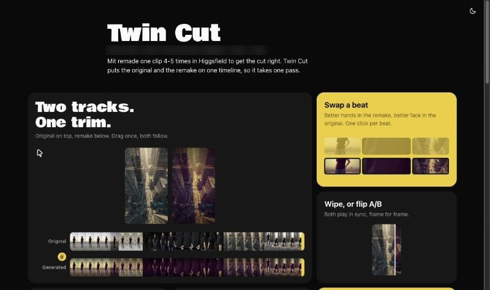
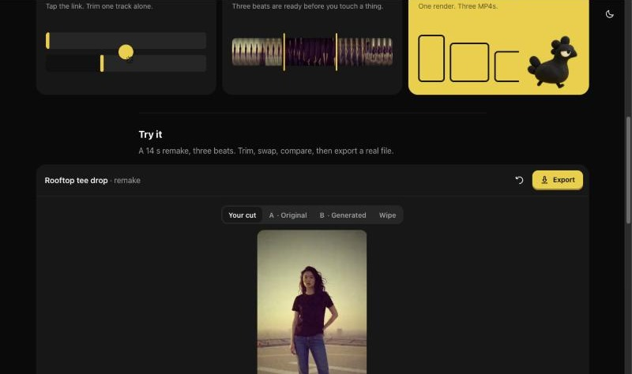
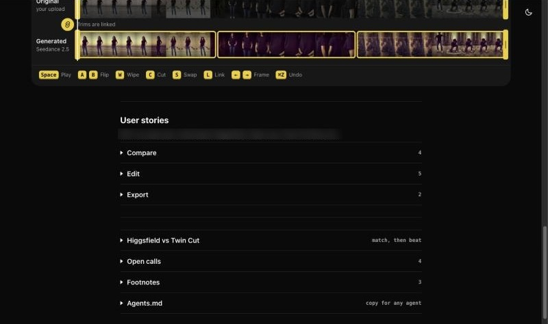

<div align="center">

# ✂️ Twin Cut

### *two tracks. one trim. the original and the AI remake, side by side.*



`product design` · `video editor` · `ai remakes` · `sloosh studio` · `nov 2026`

</div>

---

> 🎞️ **what this is.**
> a compare-and-edit timeline for AI video remakes, designed for Sloosh Studio.
> you upload a clip. an AI model remakes it. Twin Cut puts both on linked tracks.
> trim once, both follow. swap a beat. wipe between them. export a real MP4 in three sizes.
> it came straight from a teammate's pain: remaking one clip 4–5 times to get the cut right.
> this README covers the problem, the design, the shortcuts and the stories.

---

## 📍 inside

```
 1. 🍿  the short version
 2. 😩  the pain: remake, download, compare, repeat
 3. 💡  the idea: two linked tracks
 4. 🎛️  the bento: what it does
 5. 🧪  try it: a real 14-second remake
 6. ⌨️  the keyboard
 7. 🥊  matching, then beating, the other tools
 8. 📜  user stories
 9. 🛠️  how we designed it
10. 🚀  possibilities
11. 📚  lessons
```

---

## 🍿 1. the short version

AI video remakes are amazing.
Give a model your clip. Get a new version back.
Better lighting. New outfit. Different city. 🌆

But the *editing* after is painful.
You have two videos.
You want the best bits of each.
And every tool makes you juggle them separately.

Twin Cut puts them on two linked tracks.
**Original on top. Remake below.**
Drag once. Both follow.
Pick the better beat from either.
Export one clean file. ✂️

---

## 😩 2. the pain: remake, download, compare, repeat

This is what remaking a clip looked like before:

```
   THE OLD LOOP 😩

   1. 📤 upload clip to an AI video tool
   2. ⏳ wait for the remake
   3. 💾 download it
   4. 🎬 open both in a separate editor
   5. 👀 scrub back and forth, comparing by eye
   6. 😤 "the hands are better in the remake, but the face is better in the original"
   7. 🔁 go back, tweak the prompt, remake again
   8. 🔁 repeat 4–5 times
   9. ✂️ finally cut it together somewhere else
```

A teammate described doing exactly this.
Remaking one clip four or five times to get the cut right.
Every round meant downloading, re-importing, re-aligning.

The real problem wasn't the AI.
The AI was great.
The problem was **comparing and combining**.
Nobody had designed for that moment. 🎯
Every tool stopped at "your video is ready".
And left the hard part to you.

---

## 💡 3. the idea: two linked tracks

> **Two tracks. One trim.**
> *Original on top, remake below. Drag once, both follow.*

```
   TWIN CUT 🎞️🎞️

   Original   ▕▓▓▓▓▓▓▓▓▓▓│▓▓▓▓▓▓▓▓▓▓│▓▓▓▓▓▓▓▓▓▓▏  your upload
              🔗 linked trims
   Generated  ▕░░░░░░░░░░│░░░░░░░░░░│░░░░░░░░░░▏  the AI remake
                 beat 1      beat 2      beat 3
```

The original and the remake are the *same length*, with the *same beats*.
So they should live on the same timeline.
Lined up. Frame for frame.

Link them, and every edit applies to both.
Unlink them, and you can trim one alone.
Simple idea. Massive time saver. ⏱️
Five rounds of download-and-align become zero.

---

## 🎛️ 4. the bento: what it does

The page opens with a bento. Each tile shows one feature.

**✂️ Two tracks. One trim.**
Original on top. Remake below. Drag once, both follow.

**🔁 Swap a beat.**
Better hands in the remake? Better face in the original?
One click per beat.
Your final cut can be beat 1 from the original,
beat 2 from the remake,
beat 3 from the original. 🧩

**🪟 Wipe, or flip A/B.**
Both play in sync, frame for frame.
Drag a wipe line across to compare.
Or flip between them with one key.



**🔓 Unlink.**
Tap the link. Trim one track alone.
Handy when the remake runs a beat long.

**🥁 Beats come pre-cut.**
Three beats are ready before you touch a thing.
The tool finds the natural cut points for you.

**📦 One render. Three MP4s.**
Vertical, square, wide.
One click exports all three. 📱⬜🖥️
Reels, feed posts and YouTube, sorted in one go.

---

## 🧪 5. try it: a real 14-second remake

> **Try it.**
> *A 14 s remake, three beats. Trim, swap, compare, then export a real file.*

The page has a working demo.
A "rooftop tee drop" clip.
A person in a tee on a rooftop at golden hour.
The kind of shot a brand would make for a new drop.
Simple, real, and easy to judge by eye.
The remake was made with a video model in Sloosh.

Tabs across the top of the player:

```
   [ Your cut ]  [ A · Original ]  [ B · Generated ]  [ Wipe ]
```

- **Your cut:** the mix you're building.
- **A · Original:** just your upload.
- **B · Generated:** just the remake.
- **Wipe:** both, with a slider between.

And the export button is real.
It renders an actual MP4 in your browser.
Not a mockup. A file you can post. 📤

## 🎬 why beats are the right unit

A "beat" is a small chunk of a video with one job.
The hook. The reveal. The punchline.
Editors think in beats, not seconds.

```
   A 14-SECOND REMAKE, IN BEATS 🥁

   0s ──────── 4s ──────── 9s ──────── 14s
   │  BEAT 1   │  BEAT 2   │  BEAT 3   │
   │  the hook │  the walk │  the look │
   │  👀 grab   │  🚶 move   │  😎 land   │
```

Why does that matter for AI remakes?

AI models are inconsistent *across* a clip.
The first beat might be perfect.
The second might give someone six fingers. 🖐️
The third might nail the lighting.

If you can only accept or reject the *whole* remake,
you throw away the good beats with the bad.
If you can swap *per beat*,
you keep every good second from every version.

That's why Twin Cut pre-cuts beats for you.
It finds the natural cut points automatically:
scene changes, motion peaks, the moment the music shifts.
So the very first thing you see is three chunks,
ready to compare, ready to swap.

It also changes how you *prompt* for remakes.
Instead of "make the whole thing better",
you think "beat 2 needs better hands".
Smaller asks. Better results. Fewer credits.

This is a pattern for working with any AI output.
Don't judge the whole thing.
Break it into parts.
Keep the best parts.
Redo only what's broken. 🧩

---

## ⌨️ 6. the keyboard



Editors live on the keyboard.
So Twin Cut does too.

```
   TWIN CUT SHORTCUTS ⌨️

   Space    ▶️ play / pause
   A  B     🔀 flip to original / generated
   W        🪟 wipe mode
   C        ✂️ cut at playhead
   S        🔁 swap this beat
   L        🔗 link / unlink tracks
   ← →      🎞️ one frame back / forward
   ⌘Z       ↩️ undo
```

One key per action.
No menus.
Learn eight keys, edit at the speed of thought. ⚡
The shortcut bar sits right under the timeline, always visible.
Yellow key caps, plain labels.
You learn them by seeing them, not by reading a help page.

Notice the choices:
**A** and **B** for the two versions. Obvious.
**S** for swap. **W** for wipe. **L** for link.
Every key is the first letter of what it does.
You can guess them before reading the list.
That's good shortcut design. 🧠

---

## 🥊 7. matching, then beating, the other tools

The user stories section has a block called
**"[the other tool] vs Twin Cut · match, then beat."**

That's a strategy I love for product design:

```
   MATCH, THEN BEAT 🥊

   STEP 1 · MATCH   list everything users love about the tool they use today.
                    make sure we do all of it. no reason to switch back.

   STEP 2 · BEAT    find the moment that tool ignores.
                    own that moment completely.
```

Other AI video tools are great at *generating*.
None of them were great at *comparing and combining*.
So Twin Cut matches the basics (upload, remake, preview, export)
and beats them on the moment after: picking the best of both.

You don't win by being better at everything.
You win by being *much* better at the one moment people hate. 🎯

---

## 📜 8. user stories

The stories are grouped:

```
   📜 COMPARE   4 stories
   ✂️ EDIT      5 stories
   📤 EXPORT    2 stories
   🥊 the other tool vs Twin Cut · match, then beat
   ❓ OPEN CALLS   4
   📝 FOOTNOTES    3
   🤖 AGENTS.MD    copy for any agent
```

A few examples, in plain words:

- **Compare:** "As an editor, I want to see the original and the remake in sync, so I can spot which beat is better in one watch."
- **Edit:** "As an editor, I want to swap one beat from the remake into my cut without re-exporting anything."
- **Export:** "As a social manager, I want one render to give me vertical, square and wide files."

Each story has a **"Show me"** button that drives the demo to that moment. ▶️
And **Open calls** lists the decisions still to make.
Honest about what's not figured out yet.

The **Agents.md** at the end is a ready brief
for a coding agent to build the real feature inside Sloosh Studio. 🤖

---

## 🛠️ 9. how we designed it

```
   FROM COMPLAINT TO PROTOTYPE 🛠️

   🗣️ 1. listen         "i remade one clip 4–5 times to get the cut right"
        │
        ▼
   🎯 2. find the moment  not generation. comparison and combining.
        │
        ▼
   ✏️ 3. one sentence      "two tracks. one trim."
        │
        ▼
   🎛️ 4. bento             one tile per feature, shown not told
        │
        ▼
   🧪 5. working demo      real clip, real remake, real export
        │
        ▼
   📜 6. stories + agents  playable stories, open calls, Agents.md
```

### 🔑 design rules we followed

- **Dark by default.** Video editors are dark so the footage pops. 🌑
- **Yellow for actions.** Sloosh's colour marks every next step.
- **Real footage in the demo.** No grey placeholder boxes.
- **Keyboard first, mouse second.** Editors are power users.
- **One render, many sizes.** Never make people export three times.
- **Show the open questions.** Unfinished decisions are listed, not hidden.

### 🤖 a starter prompt for your own "twin" tool

```
Design a compare-and-edit tool for [two versions of something:
an original and an AI remake / two takes / v1 and v2]. Put both on
linked tracks that trim together, with an unlink toggle. Add swap-
per-section, A/B flip and a wipe slider. Make every action a single
keyboard key named after its first letter. Build a working single-
file demo with real media, an export that produces a real file,
user stories with "show me" buttons, an open-questions list and an
Agents.md brief for a coding agent.
```

---

## 🚀 10. possibilities

The "twin" idea works far beyond video.

```
   TWIN-EVERYTHING 🧩

   🖼️ images      original photo vs AI edit, swap regions
   🎙️ voice       your recording vs cloned voice, swap sentences
   📝 copy        v1 vs v2 of an ad, swap lines
   🎵 music       demo vs AI arrangement, swap sections
   🛍️ catalogues  old product shots vs new, swap per SKU
   🧑‍💻 code       human diff vs agent diff, swap hunks
```

And inside Sloosh:
- 🤖 **"Pick the best beats for me."** An AI suggests the mix. You approve.
- 👥 **Team votes.** Three teammates tap 👍 per beat. Majority wins.
- 🔁 **Remake one beat only.** Don't regenerate the whole clip. Just beat 2.

That last one is huge for cost and speed.
Regenerating 4 seconds instead of 14 saves a lot of credits. 💸

---

## 📚 11. lessons

**1. The pain is often *after* the AI.** 😩
Generation is solved-ish. Comparing and combining isn't.

**2. Same length, same beats? Same timeline.** 🎞️
If two things line up, show them lined up.

**3. Link by default, unlink on purpose.** 🔗
Most edits should apply to both.

**4. One key per action, named by its letter.** ⌨️
People guess shortcuts before they read them.

**5. Match, then beat.** 🥊
Cover the basics. Then own one moment completely.

**6. Export should be real in the demo.** 📤
A demo that makes a real file builds instant trust.

**7. List your open calls.** ❓
Saying "we haven't decided this" is a sign of a healthy design, not a weak one.

**8. Judge AI output in parts.** 🧩
Beat by beat. Keep the good seconds. Redo only what broke.

**9. Design for the person who complained.** 🗣️
The best feature briefs start as a teammate saying "this is driving me mad".
Listen for those. Write them down. Build the fix.

---

<div align="center">

```
   Original   ▓▓▓▓▓▓│▓▓▓▓▓▓│▓▓▓▓▓▓
               🔗
   Generated  ░░░░░░│░░░░░░│░░░░░░
              ───────────────────
   Your cut   ▓▓▓▓▓▓│░░░░░░│▓▓▓▓▓▓    ✂️ two tracks. one trim.
```

*part of [reverse-engineered](../README.md) by [sai](https://5aitec.com) · made with Claude*

</div>
